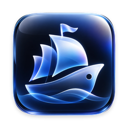

<p align="center">
  
</p>
<h1 align="center">Toplet</h1>
<p align="center"><strong>A little ship for your Mac. Built by everyone.</strong></p>
<p align="center">A free, open-source Dynamic Island experience for the macOS notch.</p>

<p align="center">
  <a href="LICENSE"></a>
  
  
  <a href="CONTRIBUTING.md"></a>
</p>

Toplet turns the unused space around your Mac's notch into something useful, interactive and
full of personality. Think of a tiny ship sailing across the notch: it shows what matters, reacts
to what is happening, and quietly makes everyday tasks easier.

**Your Mac. Your notch. Your experience.**

> Toplet is a fork of [Atoll](https://github.com/Ebullioscopic/Atoll) by Ebullioscopic and its
> contributors, which itself builds on [boring.notch](https://github.com/TheBoredTeam/boring.notch).
> It keeps their GPL-3.0 license and credits; see [Credits](#credits).

## What it does today

**Dynamic notch**
- Music controls for Apple Music, Spotify, Cider, TIDAL, Amazon Music and YouTube Music, with lyrics that can stay pinned under the closed notch.
- Live activities: timers, downloads, screen recording, Focus, privacy indicators, battery and charging, Bluetooth devices.
- Lock screen widgets for media, timers, charging, devices and weather.

**Tabs you can turn on or off**
- **Usage**: your AI plan limits in the same words as the Claude app (*Session limit · Resets in 1 hr 45 min · 47%*, *Weekly · all models*) for Claude, Codex, Cursor and more. Pin one provider and its limits stay under the closed notch.
- **Agents**: live status of Claude Code and Codex sessions, with approvals from the notch.
- **Clock**: 12- or 24-hour time, world clocks, alarms that ring even when the notch is closed, and a small "where am I" map.
- **Games**: Pairs, Tic-Tac-Toe and Lights Out. The tab stays open until you click outside, so a stray pointer never ends a game.
- **Stats, Timer, Notes (with Apple Notes sync), Clipboard, Shelf, Terminal, Color Picker.**

**A living ship**: a small original ship floats beside the closed notch when nothing else needs
the space, and reacts to real events: charging, low battery, downloads, timers, going offline and
night. It moves for a few seconds when something changes and then rests, so it costs almost nothing.

**Beautiful by design**: Liquid Glass surfaces on macOS 26 (with a matching material look on
older systems), spring animations that respect *Reduce Motion*, and an opaque fallback when
*Reduce Transparency* is on.

**Lightweight and private**: everything runs on your Mac. No account, no subscription, no
analytics. Features that need the network (weather, AI plan limits, lyrics) say so and can be
switched off.

## On the horizon

These are ideas the project is working toward, not features you can use yet. Pick one up!

- **Ship character packs**: more moods (music rhythm, weather) and community-made ships.
- **Tasks in the notch**: Apple Reminders, GitHub issues and pull requests, and other task services.
- **One-click agent setup** and an MCP server so coding agents can show progress in the notch.
- **An iPhone companion** for your limits, timers and tasks.
- **Signed releases, a DMG with a first-run guide, and a Homebrew cask.**

See the [roadmap](docs/ROADMAP.md) and [the issues](../../issues) to discuss or claim one, and
[FEATURES.md](docs/FEATURES.md) for an honest status of every feature.

## Install

Toplet does not publish signed releases yet, so for now you build it yourself. It takes a few minutes.

**Requirements**: macOS 14.6 or later on a Mac with a notch (it also works below the menu bar on other Macs),
and Xcode or the Xcode Command Line Tools.

**With Xcode**: open `Toplet.xcodeproj`, select the **Toplet** scheme and press Run.

**Without Xcode** (Command Line Tools only):

```bash
git clone https://github.com/harikiran138/Toplet.git
cd Toplet
./local/build.sh release
./local/install.sh
open ~/Applications/Toplet.app
```

The first-run guide offers Camera (for the mirror) and Calendar; you can skip both. Other permissions
(Accessibility for media keys and HUDs, Location for weather and the Clock map, Reminders, and so on)
are asked for when you first use the feature that needs them.

**Coming from Atoll?** Toplet copies your Atoll settings on first launch and renames your *Atoll*
folder in Apple Notes to *Toplet*. Because it is a new app to macOS, you grant permissions again and
turn *Launch at login* back on in Settings. Your Claude Code and Codex hooks keep working as they are.

## Quick start

- Hover over the notch to open it; move away (or click outside for Games and Clock) to close it.
- Two-finger swipe down on the notch to open it when hover-to-open is off; swipe up to close.
- Turn tabs on or off and change the look in **Settings**.
- Drop files on the notch to keep them on the Shelf, or from Terminal: `open -a Toplet /path/to/file`.

## Contributing

Developers, come aboard. Whether you are into Swift, SwiftUI, AppKit, animation, design, testing,
documentation, or you simply have a good idea, there is a place for you:

- Fork the project and experiment.
- Fix bugs and improve performance.
- Design ship characters, animations and themes.
- Build notch widgets and integrations, or an extension with the extension kit.
- Suggest features and help improve accessibility.
- Review pull requests and join technical discussions.

No contribution is too small. Start with the **[first-contribution guide](docs/CONTRIBUTOR-ONBOARDING.md)**
and **[architecture overview](docs/ARCHITECTURE.md)**, read **[CONTRIBUTING.md](CONTRIBUTING.md)** for how to build, the
pull request rules and the review process, and please follow our
**[Code of Conduct](CODE_OF_CONDUCT.md)**. Security issues go through **[SECURITY.md](SECURITY.md)**,
not public issues.

## Our open-source promise

- The app is free, and its full source is public under the **GNU GPL v3**: you can use, study,
  change and share it, and any version you distribute stays open under the same license.
- No paid account. No subscription. No mandatory online service.
- Decisions happen in public issues and pull requests.

Download it. Explore it. Improve it. Make it your own.

## Credits

Toplet stands on the shoulders of these projects and people:

- [**Atoll**](https://github.com/Ebullioscopic/Atoll) by Ebullioscopic and contributors: the app Toplet is forked from.
- [**boring.notch**](https://github.com/TheBoredTeam/boring.notch): the foundation of Atoll's media player, AirDrop surface, shelf and calendar.
- [**Alcove**](https://tryalcove.com): inspiration for the minimalistic mode and lock screen widgets.
- [**Stats**](https://github.com/exelban/stats): CPU temperature and frequency sampling.
- [**Open-Meteo**](https://open-meteo.com): weather data.
- [**SkyLightWindow**](https://github.com/Lakr233/SkyLightWindow): lock screen widget windows.
- [**rtaudio**](https://github.com/ZephyrCodesStuff/rtaudio): the live music visualizer.
- [**SwiftTerm**](https://github.com/migueldeicaza/SwiftTerm): the Terminal tab.
- [**DynamicNotch**](https://github.com/jackson-storm/DynamicNotch): battery HUDs.
- **Wick** (Nate): the iOS-style timer design for the lock screen widget.
- [**OpenUsage**](https://github.com/robinebers/openusage) and [**OpenRouter**](https://openrouter.ai): AI usage tracking and model pricing.

Third-party notices are in [NOTICE](NOTICE).

## License

Toplet is free software under the [GNU General Public License v3.0](LICENSE). It is derived from
Atoll and boring.notch, both GPL-3.0, so the whole project, including your contributions, stays
under GPL-3.0. Toplet is not affiliated with or endorsed by Apple; "Dynamic Island" refers to
Apple's iPhone feature. See [TRADEMARKS](TRADEMARKS).

<p align="center"><em>One little ship. An ocean of possibilities.</em><br>Built for macOS. Powered by the community.</p>
