# Atoll (DynamicIsland) - Local Architecture Audit

Audit target: `<repo>`, branch `local-build`, HEAD `f039ca923d1bbbf17a3610ec2cfbf017ab3bd02d` ("chore: update llm pricing data [skip ci]"), app version 2.3.3 (`VERSION`, `MARKETING_VERSION`), license GPL-3.0 (`LICENSE`, `NOTICE`: derived from boring.notch). Working tree was clean before and after the audit (`git status --short` empty). Only this document was created.

## Evidence legend

| Tag | Meaning |
|---|---|
| `[OBSERVED path:line]` | Read directly in a file (or measured by a command) during this audit. A bare file path with no line means the whole file/directory was inspected. |
| `[INFERRED]` | Reasoned from observed facts but not directly confirmed (e.g. behaviour of Xcode itself, or of an external package whose source is not on disk). |
| `[UNKNOWN]` | Could not be determined from what is on disk. |

Machine used for the audit (all `[OBSERVED]` by command): macOS 27.2 (build 26B5101f); `xcode-select -p` = `/Library/Developer/CommandLineTools`; **no Xcode.app installed** (`/Applications` has none, `xcodebuild`, `actool`, `metal`, `ibtool`, `xcstringstool` all "unable to find utility"); `swiftc` = Apple Swift 6.4 (swiftlang-6.4.0.34.1); default SDK `MacOSX.sdk` -> 27.0, with `MacOSX26.sdk`, `MacOSX26.5.sdk`, `MacOSX27.sdk`, `MacOSX27.0.sdk` present under `/Library/Developer/CommandLineTools/SDKs`; Python 3.9.6, Ruby 2.6.10, git-lfs 3.8.0.

---

## 0. One-paragraph summary

Atoll is a single-process, non-sandboxed, hardened-runtime AppKit+SwiftUI accessory app (`LSUIElement=YES`) that draws a borderless `NSPanel` ("the notch") over the menu-bar/notch area of every (or the selected) display, and hangs ~25 optional feature modules off it (media controls for 7 sources, lock-screen widgets, HUD/OSD replacement, stats, shelf/AirDrop/LocalSend, clipboard, timers, terminal, AI screenshot assistant, third-party extension server, etc.). State lives in ~112 `static let shared` singletons, 376 `Defaults` keys (sindresorhus/Defaults over `UserDefaults`), Combine `sink`s, and `NotificationCenter`. It depends on many **private macOS APIs** (CGS Spaces, SkyLight via a package, MediaRemote via a bundled Perl adapter, IOReport, DisplayServices, CoreBrightness, OSDUIHelper process suspension, SMC). The project is Xcode-only (`.xcodeproj`, objectVersion 77, no `Package.swift`) and **cannot be built with Command Line Tools alone**: on this machine's SDK 27.0 `@State` itself is a macro whose plugin is absent from CLT (verified by a scratch type-check), plus `#Preview` (65 uses), asset catalogs, a `.metal` file, string catalogs, and XCTest all need full Xcode.

---

## 1. Repository map

### 1.1 Top level (every entry)

Tracked files: 587 (`git ls-files | wc -l`). `.git` is 190 MB `[OBSERVED du -sh]`.

| Path | What it holds | Files (tracked) | Notes |
|---|---|---:|---|
| `Toplet/` | The entire app target source + resources (synchronized Xcode group) | 485 | 25 MB on disk. 363 `.swift` files / 116,833 lines. Compiled as target `DynamicIsland` -> product `Atoll.app` `[OBSERVED project.pbxproj:~150-195 PBXFileSystemSynchronizedRootGroup]` |
| `Toplet.xcodeproj/` | Xcode project (objectVersion 77), 1 shared scheme `Toplet.xcscheme`, `project.xcworkspace/xcshareddata/swiftpm/Package.resolved` (tracked although `.gitignore` lists `Package.resolved`), one stray user file `xcuserdata/admin63.xcuserdatad/xcschemes/xcschememanagement.plist` | 6 | 3 targets, see section 14 |
| `TopletTests/` | XCTest unit-test bundle (host-based, `@testable import Atoll`) | 23 | 22 test files + `Info.plist`; 4,132 lines; 276 `func test…` |
| `TopletUITests/` | XCUITest bundle | 2 | `TopletUITests.swift` (32 lines, 2 tests) + `Info.plist` |
| `tests/` | Stand-alone tests run without Xcode: 2 Python `unittest` files + 3 single-file Swift scripts | 5 | 233 Swift lines; see section 13 |
| `scripts/` | 9 Ruby `xcodeproj`-gem project-surgery scripts + `test_claude_keychain.sh` | 10 | one-off maintenance helpers, not part of the build |
| `Frameworks/` | `MediaRemoteAdapter.framework` (prebuilt, universal x86_64+arm64+arm64e, ad-hoc signed, bundle id `com.vandenbe.MediaRemoteAdapter`, min macOS 15.0 / SDK 15.5) | 6 (incl. symlinks) | Referenced by the project and by `FRAMEWORK_SEARCH_PATHS` `[OBSERVED project.pbxproj F4C1DD09…, otool -l]` |
| `mediaremote-adapter/` | Byte-identical second copy of the same framework (`cmp` identical binary) + `mediaremote-adapter.pl` (257 lines, BSD-3, (c) 2025 Jonas van den Berg) | 7 | The `.pl` is the one bundled as a resource `[OBSERVED project.pbxproj:7E8130402E3FB40500E08F3F]` |
| `Contents/Helpers/NowPlayingTestClient` | 77,848-byte arm64-only Mach-O test client (ad-hoc, linker-signed) | 1 | Copied to `Atoll.app/Contents/Helpers/` by a CopyFiles phase `[OBSERVED project.pbxproj:7EA69B1B2F5AE13500EB2D16]`; used only by `helpers/MediaChecker.swift:45` |
| `LottieAnimations/` | 6 Lottie JSONs (216 KB): `Dog waiting`, `Moody Dog`, `Orange Cat Peeping`, `Reindeer`, `Lock`, `FingerprintScan` | 6 | Added to the app's Resources phase individually `[OBSERVED project.pbxproj Resources phase]` |
| `Updates/` | Sparkle appcasts: `appcast.xml` (10 items), `appcast-beta.xml` (2), `appcast-alpha.xml` (2), `appcast-nightly.xml` (1) | 4 | `minimumSystemVersion` 14.6 `[OBSERVED Updates/appcast.xml:8]` |
| `.github/` | 7 workflows (`ci`, `release`, `nightly-merge`, `mirror-release`, `triage-slash-commands`, `update-pricing`, `validate-changelog`), `FUNDING.yml`, 2 asset images (~2 MB) | 10 | section 14 |
| `DynamicIslandSamples/` | README screenshots + a 27 MB GIF (LFS-tracked by `.gitattributes`) | 9 | 30 MB, not in any target |
| `Localizable.xcstrings` (root) | 2.6 MB string catalog, version 1.1, 796 keys, 27 locales | 1 | **Not referenced by `project.pbxproj`** (`grep -c Localizable` = 0) -> stale/duplicate of `Toplet/Localizable.xcstrings` `[OBSERVED]`/`[INFERRED stale]` |
| `ExportOptions.plist` | `method=developer-id`, team `9Y64TRM77N`, manual signing | 1 | used by `xcodebuild -exportArchive` in `release.yml` |
| `ReadMe.md`, `CHANGELOG.md` (68 KB), `CONTRIBUTING.md`, `CODE_OF_CONDUCT.md`, `LICENSE` (GPLv3), `NOTICE`, `TRADEMARKS`, `COPYRIGHT_ASSETS`, `VERSION` (`2.3.3`), `.gitignore`, `.gitattributes` | metadata | 11 | `.gitattributes`: `*.gif *.mov *.mp4` -> git-lfs; the 8 BluetoothHUD `.mov` files are real LFS-smudged QuickTime files `[OBSERVED file(1), git lfs ls-files]` |
| `docs/` | This audit (new) | 1 | created by this task |

### 1.2 `Toplet/` by subdirectory

Swift line counts measured with `find -print0 | xargs -0 cat | wc -l` (directories contain spaces: `Live activities/`, `YouTube Music Controller/`, `Preview Content/` - quote paths).

| Subdir | `.swift` files | Swift lines | Other contents | Purpose |
|---|---:|---:|---|---|
| (top-level of `Toplet/`) | 3 | 5,597 | `Info.plist`, `Toplet.entitlements`, `Toplet-Bridging-Header.h`, 6 audio files (`dynamic.m4a`, `audio-feedback.m4a`, `lock.mp3`, `unlock.mp3`, `timer.mp3`, `lowbattery.mp3`), `Localizable.xcstrings` | `DynamicIslandApp.swift` (1,815), `ContentView.swift` (3,321), `DynamicIslandViewCoordinator.swift` (461) |
| `components/` | 165 | 54,932 | | All SwiftUI/AppKit views, 26 feature subfolders (below) |
| `managers/` | 104 | 38,939 | `LLMUsage/pricing.json` | Feature controllers/singletons (73 at top level = 33,901 lines; `Extensions/` 8 files/1,519; `LLMUsage/` 16/2,771; `Spotify/` 7/748) |
| `MediaControllers/` | 12 | 4,325 | | Per-player controllers (8 files + 4 in `YouTube Music Controller/`) |
| `models/` | 13 | 3,668 | | `Constants.swift` (1,645 lines: all `Defaults.Keys`), `DynamicIslandViewModel.swift`, `BatteryStatusViewModel.swift`, etc. |
| `services/` | 7 | 1,834 | | `AtollUpdaterDelegate.swift` + `Extensions/` (XPC + WebSocket RPC server, 6 files) |
| `extensions/` | 16 | 1,636 | | Swift extensions (NSImage, PanGesture, parallax, etc.) |
| `helpers/` | 20 | 1,626 | | AppleScript helpers, permission stores, private-framework shims, `LiquidGlassBackground`, `MediaChecker`, `ScreenCaptureVisibilityManager` |
| `utils/` | 7 | 1,353 | | `SMC.swift`, `IOReportBridging.swift`, `CPUSensorCollector.swift`, `AppleHardwareInfo.swift`, `IOKitHelpers.swift`, `Logger.swift` |
| `audio/` | 5 | 1,117 | `AudioBridge.h/.mm`, `AudioProcessor.hpp/.cpp` (305 lines ObjC++/C++) | Real-time audio tap + FFT-less biquad band analyser; `PerAppVolume/` (2 swift) |
| `sizing/` | 1 | 441 | | `matters.swift` - all notch size / screen-geometry math |
| `enums/` | 2 | 434 | | `generic.swift`, `TimerDisplayMode.swift` |
| `Providers/` | 1 | 358 | | `CalendarServiceProviding.swift` (EventKit seam) |
| `animations/` | 2 | 207 | | `drop.swift` (`DynamicIslandAnimations`), `HelloAnimation.swift` (SwiftUI `Shape`) |
| `observers/` | 1 | 161 | | `FullscreenMediaDetection.swift` |
| `private/` | 1 | 87 | | `CGSSpace.swift` (private CGS Spaces wrapper) |
| `menu/` | 1 | 57 | | `StatusBarMenu.swift` (appears unused, see 15.9) |
| `Shortcuts/` | 1 | 37 | | `ShortcutConstants.swift` (KeyboardShortcuts names) |
| `strings/` | 1 | 24 | | `constants.swift` (repo + donate URLs) |
| `metal/` | 0 | 0 | `visualizer.metal` (18 lines) | Only Metal source; nothing loads it (section 5) |
| `Assets.xcassets/` | 0 | 0 | 96 files: 18 imagesets, 1 colorset, 5 appiconsets | |
| `BluetoothHUDAnimations/` | 0 | 0 | 8 `.mov` (3.1 MB, LFS) | AirPods/Beats HUD videos |
| `tr.lproj/` | 0 | 0 | `InfoPlist.strings` (Turkish permission strings) | |
| `Preview Content/` | 0 | 0 | `Preview Assets.xcassets/Contents.json` only | `DEVELOPMENT_ASSET_PATHS` |

Totals `[OBSERVED]`: 363 Swift files / 116,833 lines in `Toplet/`; +4,132 (unit tests) +32 (UI tests) +233 (`tests/`) = 121,230 Swift lines in repo. Non-Swift sources: 1 `.mm`, 1 `.cpp`, 1 `.hpp`, 2 `.h`, 1 `.metal`, 1 `.pl`.

Largest files: `components/Settings/SettingsView.swift` 9,696; `ContentView.swift` 3,321; `managers/BluetoothAudioManager.swift` 2,949; `managers/MusicManager.swift` 2,341; `components/LockScreen/LockScreenMusicPanel.swift` 2,031; `components/Notch/NotchHomeView.swift` 1,827; `DynamicIslandApp.swift` 1,815; `managers/FullScreenArtworkWindowManager.swift` 1,801.

### 1.3 `components/` subfolders (swift files / lines)

`Settings` 19/13,918; `Notch` 17/8,180; `Shelf` 33/7,416 (+ `Models/ Services/ ViewModels/ Views/`); `LockScreen` 11/5,105; `Live activities` 6/2,333; `Stats` 12/2,097; `ScreenAssistant` 4/1,852; `Calendar` 2/1,681; `Extensions` 3/1,516; `Clipboard` 5/1,512; `Music` 9/1,463; `Timer` 4/1,365; `Onboarding` 8/1,103; `ColorPicker` 3/930; `OSD` 4/778; `Focus` 1/533; `Tabs` 2/238; `Downloads` 2/209; `Network` 1/212; `Recording` 1/213; `Audio` 1/192; `Caffeinate` 1/123; `UI` 2/252; `Webcam` 1/137; `Privacy` 1/139; `Tips` 1/89; plus 11 loose files (`TestView.swift`, `WhatsNewView.swift`, `IdleAnimationView.swift`, `DynamicIslandSystemTiles.swift`, etc.).

---

## 2. Application entry points

| # | Entry point | What it is | Evidence |
|---|---|---|---|
| 1 | `@main struct DynamicNotchApp: App` | SwiftUI App lifecycle. Declares **only** a `MenuBarExtra` scene (no `WindowGroup`/`Settings` scene). Builds `SPUStandardUpdaterController(startingUpdater: !AppRuntimeEnvironment.isUITesting, updaterDelegate: AtollUpdaterDelegate())` and hands it to `SettingsWindowController.shared`. | `[OBSERVED DynamicIslandApp.swift:27-47, 51]` |
| 2 | `AppDelegate` (via `@NSApplicationDelegateAdaptor`) | The real bootstrap. `applicationDidFinishLaunching` (line 696) runs defaults migrations, starts `ExtensionXPCServiceHost` + `ExtensionRPCServer`, configures HUD/DDC/recording/DND/privacy/AudioTap managers, wires ~40 `Defaults.publisher` sinks, registers screen/space/lock observers, global shortcuts, and creates the notch window(s). `applicationWillTerminate` (281) posts `didBecomeIdle`, **SIGCONTs OSDUIHelper**, stops XPC/RPC and AudioTap, restores Lunar. | `[OBSERVED DynamicIslandApp.swift:102, 281-310, 696-1116]` |
| 3 | Mach/XPC service `com.ebullioscopic.Atoll.xpc` | `NSXPCListener(machServiceName:)` hosted **in the app process**; exported interface `AtollXPCServiceProtocol` / client `AtollXPCClientProtocol` come from the SwiftPM package `AtollExtensionKit`. Skipped under UI testing because without the `mach-services` entitlement the listener "crashes the app". Entitlement lists the same name. | `[OBSERVED services/Extensions/ExtensionXPCServiceHost.swift:25, 50-56; Toplet.entitlements:11-14]` |
| 4 | WebSocket JSON-RPC 2.0 server | `Network.framework` `NWListener` x2 (127.0.0.1 and ::1) on **TCP 9020**, WebSocket framing, methods `atoll.getVersion / requestAuthorization / checkAuthorization / present|update|dismiss LiveActivity|LockScreenWidget|NotchExperience / getShelfItems / getShelfItemData / showFilePicker / shareShelfItems / addFilesToShelf / subscribeShelfEvents`. Loopback-only binding plus per-connection peer check. | `[OBSERVED services/Extensions/ExtensionRPCServer.swift:24-26, 54, 96-107; ExtensionRPCService.swift:63-115]` |
| 5 | Distributed notifications | `com.ebullioscopic.Atoll.lifecycle.didBecomeActive/didBecomeIdle` posted on launch/terminate for extension apps; `com.apple.screenIsLocked/screenIsUnlocked` consumed. | `[OBSERVED services/Extensions/AtollDistributedNotifications.swift:14-15; DynamicIslandApp.swift:700, 1024-1029]` |
| 6 | Perl + framework "CLI adapter" | `/usr/bin/perl mediaremote-adapter.pl <Resources/MediaRemoteAdapter.framework> stream --micros` launched as a long-running child by `NowPlayingController`; JSON-lines on stdout. Also `... <NowPlayingTestClient> test` by `MediaChecker`. The `.pl` is found with `Bundle.main.url(forResource:"mediaremote-adapter", withExtension:"pl")`, the framework under `Bundle.main.resourceURL/MediaRemoteAdapter.framework` (it is in the **Resources** phase, not "Embed Frameworks"). | `[OBSERVED MediaControllers/NowPlayingController.swift:259-278; helpers/MediaChecker.swift:34-52; project.pbxproj:7E9918722EFDAE5B002EDFD5]` |
| 7 | Other child processes | `killall`, `launchctl kickstart gui/<uid>/com.apple.OSDUIHelper`, `system_profiler`, `pmset`, `ioreg`, `corebrightnessdiag`, `log`, `ps`, `lsof`, `pgrep`, `screencapture`, `networksetup`, `arp`, `zip`, `security`, `perl`. | `[OBSERVED grep executableURL/launchPath; e.g. managers/SystemOSDManager.swift:109,123; managers/BluetoothAudioManager.swift; StatsManager.swift:1455]` |
| 8 | Sparkle XPC services | Sparkle's `Downloader` and `InstallerLauncher` XPC services enabled (`SUEnableDownloaderService`, `SUEnableInstallerLauncherService` = true) and re-signed by a Release/`install`-only shell phase. | `[OBSERVED Toplet/Info.plist; project.pbxproj:502]` |
| 9 | URL/file open handlers | `application(_:open:)` and `application(_:openFile:)` route dropped/opened files to the Shelf. | `[OBSERVED DynamicIslandApp.swift:169-190]` |
| 10 | Command-line flag | `--uitesting` (DEBUG only) disables Sparkle start, XPC listener, onboarding, weather, recording/DND/privacy monitors. | `[OBSERVED helpers/AppRuntimeEnvironment.swift:22-30]` |
| 11 | Dead/alternate entry candidates | `SystemKeyObserver: NSApplication` (media-key `sendEvent` override) and `menu/StatusBarMenu.swift` have **no references** and `Info.plist` has no `NSPrincipalClass`. | `[OBSERVED grep: 0 references outside own file; Info.plist]` -> `[INFERRED dead code]` |

There are **no** helper executables, LaunchAgents, login items (other than `LaunchAtLogin` package), app extensions, or XPC bundles produced by this project (`PBXNativeTarget` list has only the app and two test bundles) `[OBSERVED project.pbxproj:PBXNativeTarget section]`. `NSApplication.setActivationPolicy(.regular)` is flipped temporarily for onboarding, then back to `.accessory` `[OBSERVED DynamicIslandApp.swift:1695, 1678; SettingsWindowController.swift:~125]`.

---

## 3. Window and overlay management

### 3.1 The notch window (`DynamicIslandWindow`)

- Class `DynamicIslandWindow: NSPanel` `[OBSERVED components/Notch/DynamicIslandWindow.swift:25]`. Created as `styleMask: [.borderless, .nonactivatingPanel]`, `.buffered` `[OBSERVED DynamicIslandApp.swift:417-423]`; `isFloatingPanel=true`, `hidesOnDeactivate=false`, `isOpaque=false`, clear background, `isMovable=false`, `hasShadow=false`, `animationBehavior=.none`, **`level = .mainMenu + 3`**, `canBecomeKey/Main = true` `[OBSERVED DynamicIslandWindow.swift:44-67]`.
- `collectionBehavior = [.fullScreenAuxiliary, .canJoinAllSpaces, .ignoresCycle, .stationary]` (`pinnedCollectionBehavior`) `[OBSERVED DynamicIslandWindow.swift:26-31]`, re-asserted on every active-Space change `[OBSERVED DynamicIslandApp.swift:397-406, 974-983]`.
- Content: `FirstMouseHostingView(rootView: ContentView().environmentObject(viewModel).environmentObject(webcamManager))` (`acceptsFirstMouse -> true`) `[OBSERVED DynamicIslandApp.swift:90-94, 428-433]`.
- **Private CGS Space at the maximum level**: every notch window is inserted into `NotchSpaceManager.shared.notchSpace` = `CGSSpace(level: 2147483647)`, which calls `CGSSpaceCreate / CGSSpaceSetAbsoluteLevel / CGSShowSpaces / CGSAddWindowsToSpaces / CGSRemoveWindowsFromSpaces / CGSHideSpaces / CGSSpaceDestroy` through `@_silgen_name` against `_CGSDefaultConnection()` `[OBSERVED managers/NotchSpaceManager.swift:32; private/CGSSpace.swift:26-87; DynamicIslandApp.swift:436, 383-385]`. This is what lets the panel stay above full-screen Spaces and the menu bar.
- The `SkyLightOperator.shared.delegateWindow(window)` call for the main notch window is **commented out** `[OBSERVED DynamicIslandApp.swift:437]`.
- Capture privacy: `ScreenCaptureVisibilityManager.register(self, scope: .entireInterface)` sets `window.sharingType = .none/.readOnly` from `Defaults[.hideDynamicIslandFromScreenCapture]` `[OBSERVED DynamicIslandWindow.swift:60; helpers/ScreenCaptureVisibilityManager.swift:66-67]`.

### 3.2 Per-display model, multi-display and lifecycle

- `windows: [NSScreen: NSWindow]` + `viewModels: [NSScreen: DynamicIslandViewModel]` when `Defaults[.showOnAllDisplays]`; otherwise a single `window` + `vm` on the preferred/`NSScreen.main` screen `[OBSERVED DynamicIslandApp.swift:104-107, 1578-1643]`. Window identity is keyed by `localizedName` (screens are matched by name, not display ID) `[OBSERVED DynamicIslandApp.swift:1612; sizing/matters.swift:342, 387-407; models/DynamicIslandViewModel.swift:377]`.
- Triggers: `NSApplication.didChangeScreenParametersNotification` -> diff of screen count/names/frames -> `cleanupWindows()` + `adjustWindowPosition()` `[OBSERVED DynamicIslandApp.swift:967-972, 1559-1576]`; `NSWorkspace.activeSpaceDidChangeNotification` -> re-pin `[974-983]`; custom `selectedScreenChanged`, `notchHeightChanged`, `automaticallySwitchDisplayChanged`, `showOnAllDisplaysChanged` `[985-1022]`.
- Lock handling: `com.apple.screenIsLocked` hides notch windows (`alpha=0`, `orderOut`); unlock restores after 1 s `[OBSERVED DynamicIslandApp.swift:312-354, 1024-1029]`. Lock-screen content is shown by *separate* SkyLight-delegated windows (3.4).
- Positioning: `x = screen.midX - w/2`, `y = screen.maxY + topBleed - h` where `topBleed = 4pt` on physical-notch screens and 0 in Dynamic-Island pill mode `[OBSERVED DynamicIslandApp.swift:441-465; sizing/matters.swift:362-367]`. Window resizing is debounced 150 ms `[OBSERVED DynamicIslandApp.swift:147-158]` and driven by `calculateRequiredNotchSize()` (line 479) which composes sizes from `sizing/matters.swift`.
- Fullscreen suppression: `FullscreenMediaDetector` (package `MacroVisionKit`) maps `screen.localizedName -> isFullscreen`, honouring `hideNotchOption` `[OBSERVED observers/FullscreenMediaDetection.swift:28-100]`.

### 3.3 Notch / display geometry (`sizing/matters.swift`, `helpers/`)

| Function / constant | Behaviour | Evidence |
|---|---|---|
| `getClosedNotchSize(screen:)` | Width = `screen.frame.width - auxiliaryTopLeftArea.width - auxiliaryTopRightArea.width + 4` (physical notch) or `Defaults[.closedNotchWidth]`; height from `safeAreaInsets.top` (`matchRealNotchSize`), menu-bar height `frame.maxY - visibleFrame.maxY` (`matchMenuBar`) or custom; non-notch displays use `nonNotchHeight(Mode)` | `[OBSERVED sizing/matters.swift:398-441]` |
| `shouldUseDynamicIslandMode(for:)` | Pill ("Dynamic Island") only if `externalDisplayStyle == .dynamicIsland` **and** `safeAreaInsets.top <= 0` | `[OBSERVED matters.swift:335-352]` |
| `openNotchSize` / `maxAllowedNotchWidth` | width = clamp(`openNotchWidth`, tab-count minimum 640/690/770, lyrics requirement, `screenWidth-60`), height 200 | `[OBSERVED matters.swift:69-95, 137-162]` |
| Constants | `notchTopScreenBleedAmount=4`, `dynamicIslandTopOffset=6`, `dynamicIslandShadowInset=14`, corner radii `(opened 19/24, closed 6/14)`, minimalistic base 420x180 (pill 340x144) | `[OBSERVED matters.swift:163-200, 362-377]` |
| Menu-bar clearance | `managers/MenuBarLayout.swift` (AX-based; `AXIsProcessTrusted` at line 111) with `MenuBarClearanceTests` | `[OBSERVED managers/MenuBarLayout.swift:111]`; purpose `[INFERRED]` |
| Flyout frame math | `managers/FlyoutFrameCalculator.swift`, `FlyoutWindowPresenter.swift` | `[OBSERVED]`; tests `FlyoutFrameCalculatorTests` |
| Shapes | `components/Notch/NotchShape.swift`, `DynamicIslandPillShape.swift` (SwiftUI `Shape`s clipping the content) | `[OBSERVED]` |

### 3.4 Every other window/panel class and its level

| Window | Class / creation | Level | Collection behaviour | SkyLight delegation | Evidence |
|---|---|---|---|---|---|
| Notch | `DynamicIslandWindow: NSPanel` | `.mainMenu + 3` + CGSSpace level `Int32.max` | fullScreenAuxiliary, canJoinAllSpaces, ignoresCycle, stationary | no (commented out) | `DynamicIslandWindow.swift:57` |
| Flyout (music control) | `NSPanel` in `FlyoutWindowPresenter` | `CGShieldingWindowLevel()` | canJoinAllSpaces, stationary, fullScreenAuxiliary | yes | `managers/FlyoutWindowPresenter.swift:257-274, 75` |
| Lock-screen music panel | `NSWindow` | `CGShieldingWindowLevel()` | same | yes | `managers/LockScreenPanelManager.swift:129-140, 174` |
| Lock-screen live activity | `NSWindow` | `CGShieldingWindowLevel()` | same | yes | `LockScreenLiveActivityWindowManager.swift:102-115, 230` |
| Lock-screen timer / reminder / weather widgets, extension widgets | `NSWindow` each | `CGShieldingWindowLevel()` | same | yes | `LockScreenTimerWidgetManager.swift:223-245`, `LockScreenReminderWidgetPanelManager.swift:98-117`, `LockScreenWeatherPanelManager.swift:96-115`, `Extensions/ExtensionLockScreenWidgetPresentationController.swift:187-204` |
| Full-screen artwork (wallpaper) | `ClickReceiverWindow: NSWindow` + 5 window builders | `CGShieldingWindowLevel()` or `desktopWindow+1` | canJoinAllSpaces, stationary, fullScreenAuxiliary | yes (3 sites) | `FullScreenArtworkWindowManager.swift:29, 1220-1300, 1364-1396, 1461-1529` |
| Vertical HUD / Circular HUD | `NSWindow` | `.screenSaver` | + ignoresCycle | yes | `VerticalHUDWindowManager.swift:205-223`, `CircularHUDWindowManager.swift:110-125` |
| Custom OSD | `NSWindow` | `.statusBar + 1` | + ignoresCycle | yes | `CustomOSDWindowManager.swift:184-200` |
| Clipboard window | `NSWindow` | `.screenSaver` | canJoinAllSpaces, fullScreenAuxiliary | no | `ClipboardWindowManager.swift:40-54` |
| Clipboard / ColorPicker / ScreenAssistant / Chat messages / Chat input / Model selection | `NSPanel` subclasses (`borderless, nonactivatingPanel`) | `.floating` | canJoinAllSpaces, fullScreenAuxiliary | no | `ClipboardPanel.swift:32-72`, `ColorPickerPanel.swift:83-114`, `ScreenAssistantPanel.swift:25-69`, `ChatPanels.swift:34-70, 108-151`, `ModelSelectionPanel.swift:34-80` |
| LocalSend device picker | `NSWindow` | `.floating` | canJoinAllSpaces, fullScreenAuxiliary | no | `LocalSendDevicePickerWindowManager.swift:78-89` |
| Settings | `SettingsWindowController: NSWindowController`, 700x600 titled `NSWindow` hosting `SettingsView` | `.normal`, `[.managed, .participatesInCycle]` | normal | no | `components/Settings/SettingsWindowController.swift:27-65` |
| Onboarding | `NSWindow` 400x600 | default | | no | `DynamicIslandApp.swift:1663-1699` |
| Sparkle update UI | custom `SPUUserDriver` `AtollUserDriver` -> `NSWindow` | `.floating` | | no | `components/Settings/CustomUpdaterViews/AtollUserDriver.swift:29, 147-156` |
| Lock-screen widget preview | titled `NSWindow` | default | | no | `LockScreenWidgetPreviewManager.swift:209-211` |

SkyLight: 13 files `import SkyLightWindow` (SwiftPM package `Lakr233/SkyLightWindow`); 11 window managers call `SkyLightOperator.shared.delegateWindow(...)` `[OBSERVED grep]`. The package's own source (which private SkyLight SPI it calls) is **not on disk**: `[UNKNOWN]` internals; `[INFERRED]` it wraps SkyLight window-delegation SPI so windows draw on the lock screen. Code comments confirm intent ("Delegate to SkyLight for proper rendering", "avoid SkyLight crashes") `[OBSERVED CustomOSDWindowManager.swift:199; LockScreenPanelManager.swift:178]`.

Other: popovers - 19 `.popover(`/`NSPopover` usages in SwiftUI (battery, clipboard, colour picker, stats, reminders, timer, per-app volume, caffeinate, media output) tracked through `@Published isXPopoverActive` flags on the view model `[OBSERVED models/DynamicIslandViewModel.swift:47-80]`. Status item: `MenuBarExtra` only (menu "Settings", "Check for Updates", "Restart Atoll", "Quit") `[OBSERVED DynamicIslandApp.swift:51-80]`; additionally `installTopMenuItemsIfNeeded` injects Focus / Accessibility / Permissions / Tools menus into `NSApp.mainMenu` `[OBSERVED DynamicIslandApp.swift:1118-1245]`.

---

## 4. State management

### 4.1 Layers

1. **View model per display**: `DynamicIslandViewModel: NSObject, ObservableObject` - `notchState (.closed/.open)`, `notchSize`, `closedNotchSize`, `contentType`, drag/drop targeting flags, ~14 `isXPopoverActive` flags, hover/auto-close suppression tokens, `open()`/`close()`/`closeForLockScreen()`/`closeHello()` `[OBSERVED models/DynamicIslandViewModel.swift:24-141, 395-485]`.
2. **Global coordinator**: `DynamicIslandViewCoordinator.shared: ObservableObject` - `@Published currentView: NotchViews` (home, shelf, timer, stats, llmUsage, colorPicker, notes, clipboard, terminal, extensionExperience), `sneakPeek`, `expandingView`, `selectedScreen`, `tabSwitchForward`, `notesLayoutState`; 9 `@AppStorage` keys (`firstLaunch`, `showWhatsNew`, `musicLiveActivityEnabled`, `timerLiveActivityEnabled`, `alwaysShowTabs`, `openLastTabByDefault`, `hudReplacement`, `preferred_screen_name`, plus `customTimerDuration` in timer views) `[OBSERVED DynamicIslandViewCoordinator.swift:97-164; enums/generic.swift:73-84]`. `SneakContentType` has 16 cases (brightness, volume, backlight, music, mic, battery, download, timer, reminder, recording, doNotDisturb, bluetoothAudio, privacy, lockScreen, capsLock, extensionLiveActivity) `[OBSERVED DynamicIslandViewCoordinator.swift:23-41]`.
3. **Feature managers as singletons**: 112 `static let/var shared` declarations `[OBSERVED grep]` (e.g. `MusicManager`, `BluetoothAudioManager`, `StatsManager`, `LockScreenManager`, `ClipboardManager`, `TimerManager`, `CalendarManager`, `WebcamManager`, `DoNotDisturbManager`, `DownloadManager`, `SystemHUDManager`, ...). `AppDelegate` holds 12 of them as stored properties so they initialise at launch `[OBSERVED DynamicIslandApp.swift:109-125]`.
4. **Reactive plumbing**: Combine `@Published` (306 occurrences in 73 files), `ObservableObject` (74 files), `.sink` (143), `Defaults.publisher` (124), `NotificationCenter.default.addObserver/publisher` (34), `DistributedNotificationCenter` (36 lines), one Swift-Observation `@Observable` class (`DownloadManager`) `[OBSERVED managers/DownloadManager.swift:83]`. Property-wrapper usage: `@Default` 581 in 51 files, `@State` 417 in 90 files, `@ObservedObject` 194, `@EnvironmentObject` 57, `@StateObject` 20, `@Binding` 87, `@MainActor` 365 `[OBSERVED grep counts]`.
5. **Mediator for derived settings**: `MediaControlsStateCoordinator` merges `showStandardMediaControls` and `enableMinimalisticUI` and caches/restores dependent toggles `[OBSERVED DynamicIslandApp.swift:1722-1815]`.
6. **Test seams**: protocols such as `MediaControllerProtocol`, `CalendarServiceProviding`, `SpotifyHTTPClient`, `CiderHTTPClient`, `ImageServiceProtocol`.

### 4.2 Persistence

| Store | What | Evidence |
|---|---|---|
| `Defaults` (sindresorhus/Defaults 9.0.3) over `UserDefaults.standard` | 376 `Key<…>` declarations in one `extension Defaults.Keys`; custom `Defaults.Serializable` models (`CustomIdleAnimation`, `NoteItem`, `ExtensionAuthorizationEntry`, `NewAPIAccount`, ...). No custom suite for Atoll's own keys. | `[OBSERVED models/Constants.swift:984-1645]`; standard suite `[INFERRED]` (no `suiteName:` for Atoll keys in grep) |
| `@AppStorage` | 9 UI-state keys (above) | `[OBSERVED DynamicIslandViewCoordinator.swift:126-155]` |
| Keychain (`Security`) | Spotify library tokens (`com.Ebullioscopic.Atoll.SpotifyLibrary`), Cider token (`…Cider`), New-API keys (`…new-api`) | `[OBSERVED managers/Spotify/SpotifyTokenStore.swift:39; MediaControllers/CiderTokenStore.swift:25; managers/LLMUsage/NewAPIUsage.swift:38]` |
| Plain-text secrets in UserDefaults | `geminiApiKey`, `openaiApiKey`, `claudeApiKey`, `groqApiKey`, `spotifySPDCCookie`, `spotifyAuthAccessToken`, legacy `spotifyLibraryAccessToken/RefreshToken`, `ciderAPIToken` | `[OBSERVED models/Constants.swift:1244-1267, 1371-1374]` (at-rest plain `[INFERRED]`) |
| Files | `~/Library/Application Support/AtollExtensions/{live_activities,lock_screen_widgets,notch_experiences}.json`; shelf persistence; clipboard history (opt-out via `persistClipboardHistory`); idle-animation imports; artwork/aerial caches; security-scoped bookmarks for shelf items | `[OBSERVED managers/Extensions/ExtensionEventBridge.swift:117-126; components/Shelf/Services/ShelfPersistenceService.swift; managers/ClipboardManager.swift; managers/IdleAnimationManager.swift; components/Shelf/Models/Bookmark.swift]` |
| Read-only reads of *other apps'* data | `~/Library/DoNotDisturb/DB/{Assertions,ModeConfigurations}.json` (needs Full Disk Access), `~/.claude/.credentials.json` + Keychain `Claude Code-credentials*`, `~/.codex/auth.json`, Cursor `state.vscdb`, Chrome/Safari/Firefox partial-download files | `[OBSERVED managers/DoNotDisturbManager.swift:46, 323, 1413; managers/LLMUsage/Quota/*.swift]` |

### 4.3 Migrations (run on every launch)

`migrateProgressBarStyle`, `migrateMusicAuxControls`, `migrateMusicControlSlots`, `migrateCapsLockTintMode`, `migrateThirdPartyDDCIntegration`, `migrateClipboardShortcutToV` `[OBSERVED models/Constants.swift:1536-1630; DynamicIslandApp.swift:713-718]`.

### 4.4 Major `Defaults` keys (grouped by the `MARK` that precedes them; counts are approximate because several MARK groups absorbed neighbours)

- **General (7)**: `updateChannel` (stable/beta/alpha/nightly/dev), `logLevel`, `menubarIcon`, `showOnAllDisplays`, `automaticallySwitchDisplay`, `releaseName`, `hideDynamicIslandFromScreenCapture`.
- **Behavior/geometry (14)**: `minimumHoverDuration`, `enableHaptics`, `openNotchOnHover`, `extendHoverArea`, `externalDisplayStyle`, `hideNonNotchUntilHover`, `notchHeightMode`, `nonNotchHeightMode`, `nonNotchHeight`, `notchHeight`, `openNotchWidth` (640), `closedNotchWidth` (150), `customizePhysicalNotchWidth`.
- **Appearance (29)**: `accentColor`, `enableShadow`, `cornerRadiusScaling`, `useModernCloseAnimation`, `lightingEffect`, `showMirror`, `mirrorShape`, `selectedCameraID`, `customIdleAnimations`, `selectedIdleAnimation`, `animationTransformOverrides`, `playerColorTinting`, `useMusicVisualizer`, `visualizerBarCount`, `enableWaveformScrubber`, `colorExtractionMode`, `customVisualizers`, `customAppIcons`, `selectedAppIconID`, `showCalendar`, `alwaysShowTabs`...
- **Gestures (7)**: `enableGestures`, `closeGestureEnabled`, `gestureSensitivity`, `enableHorizontalMusicGestures`, `musicGestureBehavior`, `reverseSwipeGestures`, `reverseScrollGestures`.
- **Media + lock screen (~75; largest bucket)**: `mediaController` (default `.appleMusic` on macOS >= 15.4 else `.nowPlaying`, line 1529), `enableRealTimeWaveform` (default false), `enableSneakPeek`, `sneakPeekStyles`, `enableFullscreenMediaDetection`, `musicControlSlots`, `musicAuxLeft/RightControl`, `showStandardMediaControls`, `autoHideInactiveNotchMediaPlayer`, `enableLockScreenMediaWidget/WeatherWidget/ReminderWidget/TimerWidget/FocusWidget`, `lockScreenWeather*` (provider, unit, AQI, refresh), `lockScreenMusic*`, `lockScreenGlassStyle`, `lockScreenWidgetAppearance`, `lockScreenShowCalendarEvent`+8 calendar-lookahead keys, `lockScreenMusicFullscreenArtworkEnabled`, `siriResponsivenessMode`.
- **Lyrics (7)**: `enableLyrics`, `lyricHighlightStyle`, `pinnedLyricContext`, `pinLyricsWhenClosed`, `lyricsPanelWidth/Offset`, `showLiveCanvasInDynamicIsland`.
- **Media controller auth (10)**: `spotifySPDCCookie`, `spotifyAuth*`, `spotifyLibraryClientID`, `spotifyLibrary*`, `legacyCiderAPIToken`.
- **Battery (22)** + **Bluetooth audio (9)**: `showPowerStatusNotifications`, `showBatteryIndicator`, `lowBatteryHUDThreshold`, `playLowBatteryAlertSound`, `showBluetoothDeviceConnections`, `useBluetoothHUD3DIcon`, `showAirPodsListeningModeChanges`, ...
- **HUD (6), System HUD (10), Custom OSD (17), 3rd-party DDC (14)**: `inlineHUD`, `progressBarStyle`, `enableSystemHUD` (true), `enableCustomOSD` (false), `enableVerticalHUD`, `enableCircularHUD`, `volumeStepPercent`, `brightnessStepPercent`, `thirdPartyDDCProvider` (BetterDisplay/Lunar), `enableExternalVolumeControlListener`, `osdMaterial`.
- **Stats (17) / LLM usage**: `enableStatsFeature` (false), `enableLLMUsageFeature` (false), `enableClaudeProvider/Codex/Cursor/Antigravity` (true when LLM usage is on), `enableNewAPIProvider`, `newAPIAccounts`, `statsUpdateInterval`, `showCpu/Memory/Gpu/Network/DiskGraph`, `cpuTemperatureUnit`.
- **Terminal (15)**: `enableTerminalFeature` (false), `terminalShellPath`, font/size/opacity/colours, `terminalScrollbackLines`, `terminalStickyMode`.
- **Timer (12)**, **Caffeinate (4)**, **ColorPicker (5)**, **Clipboard (5: `enableClipboardManager`=true, `persistClipboardHistory`)**, **Notes (10)**, **Shelf (10)**, **Downloads (5)**, **Calendar (3 + 3 third-party calendar)**, **Reminder live activity (5)**, **Per-app volume (4)**, **Screen recording (5)**, **Focus/DND (5)**, **Privacy indicators (2)**, **Caps lock (6)**, **Lock-screen features (3)**.
- **Screen Assistant (10)**: `enableScreenAssistant` (true), `screenAssistantDisplayMode`, `geminiApiKey`, `openaiApiKey`, `claudeApiKey`, `groqApiKey`, `selectedAIProvider`, `selectedAIModel`, `enableThinkingMode`, `localModelEndpoint` (`http://localhost:11434`).
- **Third-party extensions (14)**: `enableThirdPartyExtensions` (true), `enableExtensionLiveActivities`, `...LockScreenWidgets`, `...NotchExperiences`, `extensionAuthorizationEntries`, `extensionRateLimitRecords`, capacities, `enableExtensionFileSharing`.

---

## 5. Animation infrastructure

| Mechanism | Where | Evidence |
|---|---|---|
| SwiftUI implicit/explicit animation | 289 `withAnimation`, 190 `.animation(`, 9 `matchedGeometryEffect`, 7 `TimelineView`, 22 `Canvas`; no `phaseAnimator`/`keyframeAnimator` | `[OBSERVED grep counts]` |
| Central animation constants | `DynamicIslandAnimations.animation` = `.spring(.bouncy(duration: 0.4))` for notch style, else `timingCurve(0.16,1,0.3,1,0.7)`; file says "TODO: Move all animations to this file" | `[OBSERVED animations/drop.swift:21-40]` |
| Shape morph | `NotchShape`, `DynamicIslandPillShape`, opened/closed corner radii in `matters.swift`; window resize is a separate debounced AppKit `setFrame` (animated via `NSAnimationContext`, 16 uses) | `[OBSERVED components/Notch/*.swift; DynamicIslandApp.swift:646-695]` |
| Hand-drawn vector | `HelloShape` (a ~30-curve `Path`) used for the first-launch "hello" | `[OBSERVED animations/HelloAnimation.swift:19-60]` |
| Lottie (Airbnb Lottie via `LottieUI`) | 6 bundled JSONs (4 idle animations loaded by name from `Bundle.main`; `Lock.json` and `FingerprintScan.json` for the lock activity); user-imported JSONs stored in app storage; a default **remote** URL `https://assets9.lottiefiles.com/packages/lf20_mniampqn.json` in `LottieAnimationView`; 6 files import `LottieUI`, 5 import `Lottie` (transitive via `lottie-spm`) | `[OBSERVED managers/IdleAnimationManager.swift:111-122; components/Music/LottieAnimationView.swift:24-35; components/IdleAnimationView.swift:20-71; Package.resolved lottie-spm]` |
| Core Animation layers | `AudioSpectrum: NSView` (`MusicVisualizer.swift:28`) and `RealTimeAudioSpectrum: NSView` (`audio/RealTimeAudioSpectrum.swift:29`) draw bars with `CALayer`s; `SparkleNSView` (onboarding) uses a layer with `NSImage("sparkle")`; 1 `CABasicAnimation`-family use; 8 CAShapeLayer/Gradient-type uses | `[OBSERVED grep counts and the cited files]` |
| Video | 8 AirPods/Beats `.mov` HUD animations loaded with `Bundle.main.url(forResource:withExtension:"mov", subdirectory:"BluetoothHUDAnimations")` with a flat fallback; animated Apple Music artwork and aerial wallpapers played through `AVPlayer`-based `LoopingVideoView` | `[OBSERVED managers/BluetoothAudioManager.swift:2836-2844; managers/FullScreenArtworkWindowManager.swift:41]` |
| Parallax | `View+Parallax3D.swift`, `Defaults.parallaxEffectIntensity` | `[OBSERVED extensions/View+Parallax3D.swift]` |
| Liquid Glass | `.glassEffect(.clear.interactive()...)` x8 in 7 files behind `#available(macOS 26.0, *)`; plus a private-class path: `NSClassFromString("NSGlassEffectView")` with a private `set_variant:` setter | `[OBSERVED grep; helpers/LiquidGlassBackground.swift:214-221, 180-206]` |

### 5.1 Metal shaders - how `.metal` is consumed

- The **only** Metal source is `Toplet/metal/visualizer.metal` (18 lines): a trivial `vertexShader(vertex_id, constant float2 *vertices)` and `fragmentShader(constant float4 &color)` `[OBSERVED metal/visualizer.metal]`.
- **Nothing consumes it**: no `ShaderLibrary`, `.colorEffect/.layerEffect/.distortionEffect`, `MTLCreateSystemDefaultDevice`, `makeDefaultLibrary`, `MTKView`, `CAMetalLayer`, `import Metal/MetalKit`, no `default.metallib` string, and no `vertexShader`/`fragmentShader` string anywhere outside the `.metal` file `[OBSERVED grep over DynamicIsland, tests]`. The audio visualizer is CALayer-based (above).
- Because the folder is a **file-system-synchronized group**, Xcode will compile this file into the app's `default.metallib` (`MTL_FAST_MATH=YES`, `MTL_ENABLE_DEBUG_INFO` set in build settings) `[OBSERVED project.pbxproj:713-714, 770-771]`; synchronized-group inclusion of `.metal` into Compile Sources is `[INFERRED]` Xcode behaviour. Runtime impact: none; build impact: needs the Metal compiler (section 15).
- `INFOPLIST_KEY_MetalCaptureEnabled = YES` is set `[OBSERVED project.pbxproj:811, 886]`.

---

## 6. Media integration

### 6.1 Controller architecture

`MediaControllerProtocol` (play/pause/seek/next/prev/togglePlay/shuffle/repeat/isActive/`playbackStatePublisher` + favouriting capability members) `[OBSERVED MediaControllers/MediaControllerProtocol.swift:24-93]`. `MusicManager.shared` (2,341 lines) owns one active controller, created by `createController(for:)` from `Defaults[.mediaController]` (`MediaControllerType`: Now Playing, Apple Music, Spotify, Youtube Music, Amazon Music, TIDAL, Cider) `[OBSERVED managers/MusicManager.swift:826-870; models/Constants.swift:450-460]`. It also does lyrics, artwork, liked-state, explicit-flag, live-stream detection, sneak-peek updates and Pear-Desktop auto-switch (`com.github.th-ch.youtube-music` launch -> YouTubeMusicController) `[OBSERVED MusicManager.swift:775-815]`.

| Controller | Transport | Private/entitled bits | Evidence |
|---|---|---|---|
| `NowPlayingController` | **Two paths**: (a) commands/seek/shuffle/repeat via private `MediaRemote.framework` loaded with `CFBundleCreate` + `CFBundleGetFunctionPointerForName("MRMediaRemoteSendCommand"/"SetElapsedTime"/"SetShuffleMode"/"SetRepeatMode")`; (b) state via `/usr/bin/perl mediaremote-adapter.pl <framework> stream --micros` JSON lines | private MediaRemote; macOS 15.4+ entitlement workaround via Apple-signed `perl` hosting the adapter framework `[INFERRED mechanism]` | `NowPlayingController.swift:66-92, 259-305` |
| `AppleMusicController` | AppleScript `tell application "Music"`; `NSAppleScript` via `AppleScriptHelper` | Automation TCC, `com.apple.Music` Apple-event exception | `AppleMusicController.swift:336, 371, 430-443` |
| `SpotifyController` | AppleScript `tell application "Spotify"` + HTTP: `api.spotify.com/v1/tracks/…`, `open.spotify.com/embed/track/…`, `spclient.wg.spotify.com/canvaz-cache/v0/canvases` (Canvas videos, needs `sp_dc` cookie) | `SpotifyAuthManager` fetches secrets from `raw.githubusercontent.com/xyloflake/spot-secrets-go/…/secretDict.json` and `open.spotify.com/api/token`; `SpotifyOAuthService` uses `accounts.spotify.com` (PKCE via `ASWebAuthenticationSession`) | `SpotifyController.swift:343-380, 476, 520, 621; managers/SpotifyAuthManager.swift:36-37; managers/Spotify/SpotifyOAuthService.swift:39-40` |
| `YouTubeMusicController` (+ `…Authentication`, `…Models`, `…Networking`) | HTTP + WebSocket to the **th-ch/youtube-music (Pear Desktop) API server** at `http://localhost:26538`: `POST /auth/DynamicIsland` -> bearer token, `GET /api/v1/song`, commands at `/api/v1/<endpoint>`, 2 s update interval, reconnect backoff 1-60 s; bundle id `com.github.th-ch.youtube-music` | none | `YouTubeMusic Controller/YouTubeMusicModels.swift:24-40; …Networking.swift:25-80; …Authentication.swift:24-60` |
| `CiderController` (+ `CiderTokenStore`) | HTTP `http://localhost:10767/api/v1/playback` with token in Keychain | none | `CiderController.swift:85-110` |
| `AmazonMusicController` | Uses the same private MediaRemote function-pointer set (30 hits) and the perl adapter | private MediaRemote | `AmazonMusicController.swift:44-89, 190` |
| `TidalController` | Process/audio-activity detection via `AudioProcessQuery`; favourite/shuffle/repeat read & written by **Accessibility** (`AXIsProcessTrusted`) because TIDAL exposes no MR command | Accessibility TCC | `TidalController.swift:28, 58-66, 81-145, 168` |

### 6.2 mediaremote-adapter details

- Perl script uses `DynaLoader::dl_load_file` on the framework binary; functions `stream/get/send/seek/shuffle/repeat/speed/test`; accepts an optional `NOWPLAYING_CLIENT` path (env var) `[OBSERVED mediaremote-adapter/mediaremote-adapter.pl:20-110]`.
- Framework binary: Mach-O universal x86_64/arm64/arm64e, links Foundation/AppKit/JavaScriptCore/UTType, `minos 15.0`, ad-hoc signed, `TeamIdentifier=not set` `[OBSERVED otool, codesign -dv]`.
- `MusicManager.init` calls `MediaChecker.checkDeprecationStatus()` (runs `perl <script> <framework> <NowPlayingTestClient> test`, 10 s timeout, exit status 1 = "deprecated") and falls back to Apple Music when Now-Playing is unusable `[OBSERVED helpers/MediaChecker.swift:33-107; managers/MusicManager.swift:745-770, 872-886]`.
- `NowPlayingTestClient` is arm64-only, so the deprecation probe cannot run on Intel `[OBSERVED file(1)]` (the app falls back, `[OBSERVED MusicManager.swift:751-753]`).

### 6.3 AppleScript / ScriptingBridge

`NSAppleScript` is used in 9 files (`AppleScriptRunner`, `AppleScriptHelper`, `AppleMusicController`, `SpotifyController`, `AppleNotesSyncManager` (`tell application "Notes"` x5), `AppleMusicAirPlayManager`, `SystemVolumeManager`, `ScreenRecordingManager` (`System Events` Cmd-Ctrl-Esc to stop recording), `DynamicIslandSystemTiles`). **No ScriptingBridge** (`SBApplication` not found) `[OBSERVED grep]`.

### 6.4 Audio capture & per-app volume (media-adjacent)

- `AudioTap` (singleton NSObject): `CATapDescription()` + `AudioHardwareCreateProcessTap` + private aggregate device `Atoll_Virtual_Tap` + `AudioDeviceCreateIOProcID` for a live music waveform; feeds ObjC++ `AudioBridge` -> C++ `AudioProcessor` (Accelerate `vDSP_biquad` filter bank, `vDSP_rmsqv`); header credits ZephyrCodesStuff/rtaudio `[OBSERVED audio/AudioTap.swift:109-303; audio/AudioBridge.mm; audio/AudioProcessor.cpp]`. Off by default (`enableRealTimeWaveform=false`, `Constants.swift:1064`); app-launch observers restart capture for Music/Spotify/Safari etc. `[OBSERVED DynamicIslandApp.swift:193-278]`.
- `AppVolumeTap` + `PerAppVolumeManager` use `CATapDescription(stereoMixdownOfProcesses:)` per process for per-app volume/mute (off by default) `[OBSERVED audio/PerAppVolume/AppVolumeTap.swift:65-71; Constants.swift:1341]`.

### 6.5 Lyrics and artwork

LRCLIB `https://lrclib.net/api/search?...` (primary), NetEase `music.163.com/api/search/get/web`, `…/api/song/lyric` (fallback); iTunes Search `itunes.apple.com/search` for artwork/explicit flag; Apple Music catalog `api.music.apple.com/v1/catalog/<storefront>` + `mvod.itunes.apple.com` for animated artwork (MusicKit authorization) `[OBSERVED managers/MusicManager.swift:233, 1912; managers/NetEaseLyrics.swift:95-103; managers/AnimatedArtworkManager.swift:159-187]`.

---

## 7. Battery and hardware monitoring

| Area | Files | API used | Private? |
|---|---|---|---|
| Battery % / charging / time-to-full | `managers/BatteryActivityManager.swift`, `MacBatteryManager.swift`, `models/BatteryStatusViewModel.swift` | `IOPSNotificationCreateRunLoopSource`, `IOPSCopyPowerSourcesInfo/List`, `IOPSGetPowerSourceDescription`, `kIOPSTimeToFullChargeKey` | public IOKit (`import IOKit.ps`) `[OBSERVED BatteryActivityManager.swift:92, 239-282]` |
| Bluetooth audio devices + battery | `managers/BluetoothAudioManager.swift` (2,949 lines) | `IOBluetooth`, `CoreBluetooth` (`CBCentralManager`, battery service UUID), distributed notifications `com.apple.Bluetooth.*`, reads `/Library/Preferences/com.apple.Bluetooth` as a UserDefaults suite, spawns `system_profiler`, `ioreg`, `pmset`, `log`; AirPods listening-mode via `NSSelectorFromString` | semi-private (notification names, prefs plist, selector calls) `[OBSERVED BluetoothAudioManager.swift:24-26, 43, 115-121, 2082, 2310]` |
| CPU/GPU/memory/network/disk stats | `managers/StatsManager.swift` (1,544), `MemoryUsageMonitor.swift` | `host_statistics`, `host_statistics64`, `host_processor_info`, `sysctlbyname(kern.memorystatus_vm_pressure_level, vm.swapusage)`, `getifaddrs`, `IOServiceMatching(kIOAcceleratorClassName)` (GPU), `IOServiceMatching("IOStorage")`, `/bin/ps`, `proc_pidinfo`, `task_info` | public |  `[OBSERVED StatsManager.swift:109-131, 795, 867, 905, 919, 987, 1032, 1303, 1455, 1540]` |
| CPU temperature | `utils/SMC.swift` (`IOServiceMatching("AppleSMC")`, `IOServiceOpen`, key `Tp**`/`Te**`/`Tf**`/`TC0*` tables per Apple-silicon generation), `utils/CPUSensorCollector.swift` | AppleSMC user client | **private** SMC protocol `[OBSERVED SMC.swift:162-190; CPUSensorCollector.swift:58-65, 236-250]` |
| CPU/GPU power & frequencies | `utils/IOReportBridging.swift`, `CPUSensorCollector.swift` | `dlopen("/System/Library/PrivateFrameworks/IOReport.framework/IOReport")` + `dlsym` of `IOReportCopyChannelsInGroup/MergeChannels/CreateSubscription/CreateSamples/...` | **private** `[OBSERVED IOReportBridging.swift:26-44; CPUSensorCollector.swift:43-210]` |
| SoC identification | `utils/AppleHardwareInfo.swift`, `IOKitHelpers.swift` | `sysctlbyname("machdep.cpu.brand_string","hw.logicalcpu")`, `IOServiceMatching("AppleARMPE")`, `AppleARMIODevice` registry walk | registry names private-ish `[OBSERVED AppleHardwareInfo.swift:76-159]` |
| Display brightness | `managers/SystemMediaControllers.swift` (`SystemBrightnessController` l.643), `helpers/DisplayServicesDynamic.swift`, `helpers/CoreBrightnessDisplayClient.swift`, `managers/SystemDisplayManager.swift` | `dlopen(DisplayServices)` -> `DisplayServicesGetBrightness/SetBrightness`; `NSClassFromString` on CoreBrightness client + `brightnessForDisplay:` / `setNotificationBlock:`; `IODisplayGetFloatParameter`; `/usr/libexec/corebrightnessdiag status-info` for M1 | **private** `[OBSERVED DisplayServicesDynamic.swift:34-44; CoreBrightnessDisplayClient.swift:28-72; SystemDisplayManager.swift:49-76]` |
| Keyboard backlight | `managers/KeyboardBrightnessSensor.swift`, `SystemKeyboardBacklightController.swift` | `NSClassFromString("KeyboardBrightnessClient")` selectors; IOKit `AppleHIDKeyboardEventDriverV2` property `KeyboardBrightnessBacklight`; `corebrightnessdiag` | **private** `[OBSERVED KeyboardBrightnessSensor.swift:88-171]` |
| Volume | `SystemVolumeController` (CoreAudio property listeners), `SystemVolumeManager` | `AudioObject*` APIs | public `[OBSERVED SystemMediaControllers.swift:63-110]` |
| Camera / mic in use | `CameraMonitor.swift`, `MicrophoneMonitor.swift`, `PrivacyIndicatorManager.swift` | `AVCaptureDevice.DiscoverySession`, `CoreMediaIO` (import), `kAudioDevicePropertyDeviceIsRunningSomewhere` listeners | public |
| Screen recording detection | `ScreenRecordingManager.swift` | private `CGSIsScreenWatcherPresent`, `CGSRegisterNotifyProc` via `@_silgen_name`; `pgrep screencapture` | **private** `[OBSERVED ScreenRecordingManager.swift:22-34, 314-340]` |
| Wi-Fi/network state | `NetworkConnectivityManager.swift` | `NWPathMonitor`, `CWWiFiClient` (CoreWLAN), `networksetup` | public `[OBSERVED :43-45, 276]` |
| Do Not Disturb / Focus | `DoNotDisturbManager.swift` (1,514) | reads `~/Library/DoNotDisturb/DB/*.json` (FDA), `/usr/bin/log` stream, selector calls | semi-private `[OBSERVED :46, 323, 1088-1095, 1413]` |
| Caps Lock | `CapsLockManager.swift` | `NSEvent.addGlobalMonitorForEvents(.flagsChanged)` | public |
| Caffeinate | `CaffeinateManager.swift` | IOKit power assertions (`IOKit.pwr_mgt`) | public |
| Siri visibility | `SiriVisibilityMonitor.swift` | (workspace/window polling) | `[UNKNOWN details]` |

---

## 8. Settings UI structure

- Host: `SettingsWindowController.shared` (`NSWindowController`, 700x600 titled/resizable `NSWindow`, `NSHostingView(SettingsView)`) `[OBSERVED SettingsWindowController.swift:27-65]`; opened from the menu-bar extra, notch header gear, or onboarding.
- `SettingsView` (`SettingsView.swift:608`): `NavigationSplitView` with a searchable sidebar (`SettingsSidebarSearchBar`, `SettingsSearchEntry`, `SettingsHighlightCoordinator` highlights the matched control), `List(selection:)` of `SettingsTab`, detail pane per tab, `.formStyle(.grouped)`, Liquid-Glass background on macOS 26 else `.ultraThinMaterial` `[OBSERVED SettingsView.swift:171-208, 493-586, 608-700]`.
- **21 tabs in 8 groups** `[OBSERVED SettingsView.swift:21-130]`: core (General, Appearance); Media & Display (Media, Live Activities, Lock Screen, Devices); System (Controls [HUD/OSD], Battery); Productivity (Timer, Calendar, Notes); Utilities (Clipboard, Screen Assistant, Color Picker, Shelf, Downloads, Shortcuts); Developer (Stats, Terminal); Integrations (Extensions); About.
- Tab views (all in `SettingsView.swift` unless noted): `GeneralSettings:1119`, `LiveActivitiesSettings:4600`, `Appearance:4861`, `LockScreenSettings:5638` (+ positioning/preview helpers to ~7100), `Media:3156`, `DevicesSettingsView:2720`, `ExtensionsSettings` (separate file), `TimerSettings:7377`, `CalendarSettings:3671`, `HUDAndOSDSettingsView:1959` (+ `ExternalDisplayIntegrationsSection:2426`, `CustomOSDSettings:8951`), `Charge:1462` (battery), `StatsSettings:7974`, `ClipboardSettings:8463`, `ScreenAssistantSettings:8651`, `ColorPickerSettings:8829`, `Shelf:4415`, `Downloads:1712`, `Shortcuts:7107` (KeyboardShortcuts recorders), `NotesSettingsView:9219`, `TerminalSettings:9318`, `About:4125`.
- Separate files in `components/Settings/`: `AnimationEditorView`, `IdleAnimationsSettingsSection`, `SpotifyAuthSettingsSection`, `SpotifyLoginSheet` (WKWebView login to capture `sp_dc`), `SpotifyLikeButtonSettingsSection`, `CiderFavoritingSettingsSection`, `MusicSlotConfigurationView`, `MediaSourceCapabilities`, `EditPanelView`, `ListItemPopover`, `SoftwareUpdater`, and `CustomUpdaterViews/` (5 files: Sparkle user-driver screens).
- `SettingsPermissionCallout` (line 9155) and `FullDiskAccessPermissionStore` / `AccessibilityPermissionStore` surface TCC status inline `[OBSERVED SettingsView.swift:9155; helpers/*PermissionStore.swift]`.
- Everything binds to `Defaults` via `@Default(.key)`; there is no separate settings model.

---

## 9. Permissions and entitlements

### 9.1 Entitlements file `[OBSERVED Toplet/Toplet.entitlements]`

| Key | Value | Note |
|---|---|---|
| `com.apple.security.cs.disable-library-validation` | true | lets hardened runtime load the ad-hoc-signed `MediaRemoteAdapter.framework` and unsigned SPM frameworks |
| `com.apple.security.device.camera` | true | Mirror mode, `WebcamManager` |
| `com.apple.security.mach-services` | `com.ebullioscopic.Atoll.xpc` | extension XPC listener |
| `com.apple.security.automation.apple-events` | true | AppleScript to Music/Spotify/Notes/System Events |
| `com.apple.security.personal-information.calendars` | true | EventKit |
| `com.apple.security.temporary-exception.apple-events` | `com.spotify.client`, `com.apple.Music`, `com.apple.Notes` | irrelevant when not sandboxed `[INFERRED]` |
| `com.apple.security.temporary-exception.mach-lookup.global-name` | `$(PRODUCT_BUNDLE_IDENTIFIER)-spks`, `-spki` | Sparkle sandbox services, irrelevant when not sandboxed `[INFERRED]` |
| *(absent)* `com.apple.security.app-sandbox` | - | `ENABLE_APP_SANDBOX = NO` `[OBSERVED project.pbxproj:791, 866]`; hardened runtime YES (792, 867) |
| *(absent)* `com.apple.security.device.audio-input` | - | `ENABLE_RESOURCE_ACCESS_AUDIO_INPUT = NO` `[OBSERVED :794, 869]` while Screen Assistant records microphone audio with `AVAudioRecorder` (`ScreenAssistantManager.swift:121, 305`) -> under hardened runtime the mic would be denied `[INFERRED risk]` |

`ENABLE_RESOURCE_ACCESS_CALENDARS/CAMERA/LOCATION = YES` are build settings that make Xcode inject the matching hardened-runtime entitlements at signing `[INFERRED]` (no `…personal-information.location` key in the file; `tests/test_privacy_configuration.py` asserts camera and apple-events survive re-signing).

### 9.2 Info.plist usage-description keys (generated from `INFOPLIST_KEY_*` build settings + `Toplet/Info.plist`)

`NSAppleEventsUsageDescription`, `NSBluetoothAlwaysUsageDescription`, `NSCalendarsFullAccessUsageDescription`, `NSCalendarsUsageDescription`, `NSCameraUsageDescription`, `NSDesktopFolderUsageDescription`, `NSDocumentsFolderUsageDescription`, `NSDownloadsFolderUsageDescription`, `NSLocationUsageDescription`, `NSLocationWhenInUseUsageDescription`, `NSMicrophoneUsageDescription`, `NSRemindersFullAccessUsageDescription`, `NSRemindersUsageDescription` `[OBSERVED project.pbxproj:811-825 (Debug), 886-900 (Release)]`; from the plist file: `NSAppleMusicUsageDescription`, `NSAudioCaptureUsageDescription`, `NSScreenCaptureUsageDescription`, `SUFeedURL`, `SUPublicEDKey`, `SUEnableDownloaderService`, `SUEnableInstallerLauncherService`, `NSAppTransportSecurity/NSAllowsArbitraryLoads = true`, and an empty `UTImportedTypeDeclarations` array `[OBSERVED Toplet/Info.plist]`. Other keys: `LSUIElement=YES`, `LSApplicationCategoryType=public.app-category.utilities`, `MetalCaptureEnabled=YES`. `Info.plist` is excluded from target membership by an exception set and merged through `INFOPLIST_FILE` + `GENERATE_INFOPLIST_FILE=YES` `[OBSERVED project.pbxproj:7EA69B212F5B100000EB2D16]`. Turkish translations in `tr.lproj/InfoPlist.strings`.

### 9.3 TCC / OS permission by feature

| Permission | Trigger | Code | Default state |
|---|---|---|---|
| Accessibility | media-key event tap (`CGEvent.tapCreate`), TIDAL control, Clock-timer mirroring, menu-bar geometry, fullscreen detection | `MediaKeyInterceptor.swift:160-229, 465-469`; `TidalController.swift:168`; `SystemTimerBridge.swift:119-375`; `MenuBarLayout.swift:111`; `observers/FullscreenMediaDetection.swift:123`; `helpers/AccessibilityPermissionStore.swift` | prompted when HUD interception / those features are on |
| Full Disk Access | DND/Focus detection (custom focus modes) | `helpers/FullDiskAccessPermissionStore.swift:23-60` (probes `TCC.db`, `ModeConfigurations.json`); `DoNotDisturbManager.swift:192-317` | `enableDoNotDisturbDetection=true` |
| Automation (Apple Events) | Music, Spotify, Notes, System Events | `NSAppleScript` sites above | on use |
| Calendars + Reminders (full access) | `EKEventStore.requestFullAccessToEvents/Reminders` | `Providers/CalendarServiceProviding.swift:45-59`; onboarding `OnboardingView.swift:153-157` | requested in onboarding / `CalendarManager` |
| Camera | Mirror, onboarding | `WebcamManager.swift:129`, `OnboardingView.swift:153` | `showMirror=false` |
| Microphone | Screen Assistant voice recording | `ScreenAssistantManager.swift:121,305` | feature on by default; recording only on use |
| Audio Capture (system audio recording) | `AudioHardwareCreateProcessTap` | `audio/AudioTap.swift:248-256`, `AppVolumeTap.swift:65-71` | waveform and per-app volume default off |
| Screen Recording | AI assistant screenshots via `/usr/sbin/screencapture`; full-screen capture | `components/ScreenAssistant/ScreenshotSnippingTool.swift:78-120` | on use |
| Location (When In Use) | lock-screen weather | `LockScreenWeatherManager.swift:1098-1107` | `enableLockScreenWeatherWidget=true` -> prompt on first launch (`DynamicIslandApp.swift:1104-1109`) |
| Bluetooth | device connect/battery HUD | `BluetoothAudioManager.swift:2310` (`CBCentralManager`) | `showBluetoothDeviceConnections` |
| Apple Music / MusicKit | animated artwork | `AnimatedArtworkManager.swift:105-109` | on use |
| Files & Folders (Desktop/Documents/Downloads) | shelf, screenshots, download monitor | Info.plist keys; `DownloadManager.swift` | `enableDownloadListener=true` |
| Keychain prompt | reading Claude Code / Codex credentials | `managers/LLMUsage/Quota/KeychainReader.swift` | `enableLLMUsageFeature=false` |
| Local Network | LocalSend multicast `224.0.0.167:53317` + TCP listener 53317 + `arp` | `components/Shelf/Services/LocalSendService.swift:60-61, 96, 627` | shelf quick-share |
| Notifications | none found (`UNUserNotificationCenter` not used) | grep | - |
| Input Monitoring | `NSEvent.addGlobalMonitorForEvents` for mouse/scroll/flags (does not require TCC for these event types) | `ContentView.swift:2236, 2281; PanGesture.swift:100; CapsLockManager.swift:47` | - |
| Network (outbound) | App Transport Security fully open | `Info.plist` | - |

---

## 10. External services and network endpoints

All URL/host literals in Swift sources (62 matches; extracted by regex over `Toplet/**/*.swift`):

| Host / endpoint | Purpose | File:line | Default-on? |
|---|---|---|---|
| `raw.githubusercontent.com/Ebullioscopic/Atoll/main/Updates/{appcast,appcast-beta,appcast-alpha,appcast-nightly}.xml` | Sparkle feed (also `SUFeedURL` in Info.plist = stable); `.dev` channel reuses nightly feed | `models/UpdateChannel.swift:53-61`; `Info.plist`; `services/AtollUpdaterDelegate.swift:26` | yes (Sparkle starts unless UI-testing) |
| `github.com/Ebullioscopic/Atoll/releases/download/vX/Atoll-X.dmg` | update payload (from appcast) | `Updates/appcast.xml` | on update |
| `raw.githubusercontent.com/Ebullioscopic/Atoll/dev/DynamicIsland/managers/LLMUsage/pricing.json` | LLM price table refresh | `managers/LLMUsage/ModelPricingManager.swift:98` (fetch in `init`, line ~100) | when pricing manager is instantiated |
| `ebullioscopic.github.io/Toplet/privacy-policy`, `github.com/Ebullioscopic/DynamicIsland`, `buymeacoffee.com/kryoscopic`, `linkedin.com/in/hariharan-mudaliar/`, `getatoll.app/marketplace` | links only | `components/Onboarding/*`, `strings/constants.swift:21-22`, `Settings/ExtensionsSettings.swift:72` | - |
| `wttr.in`, `api.open-meteo.com/v1/forecast`, `air-quality-api.open-meteo.com/v1/air-quality` | lock-screen weather / AQI | `managers/LockScreenWeatherManager.swift:626, 712, 798` | yes (`enableLockScreenWeatherWidget=true`) |
| `lrclib.net/api/search`, `music.163.com/api/search/get/web`, `music.163.com/api/song/lyric` | lyrics | `MusicManager.swift:1912`; `NetEaseLyrics.swift:95,103` | when lyrics enabled |
| `itunes.apple.com/search` | artwork/explicit lookup | `MusicManager.swift:233` | with media |
| `api.music.apple.com/v1/catalog/<storefront>`, `mvod.itunes.apple.com` | animated artwork (MusicKit) | `AnimatedArtworkManager.swift:159, 187` | opt-in |
| `api.spotify.com/v1`, `open.spotify.com/{embed/track,api/token}`, `accounts.spotify.com/{authorize,api/token,en/login}`, `spclient.wg.spotify.com/canvaz-cache/v0/canvases`, `developer.spotify.com/dashboard` | Spotify metadata, library/like, canvas | `SpotifyController.swift:476-621`; `Spotify/SpotifyLibraryAPI.swift:27`; `SpotifyOAuthService.swift:39-40`; `SpotifyAuthManager.swift:36-37, 155`; `SpotifyLoginSheet.swift:25-36` | when Spotify configured |
| `raw.githubusercontent.com/xyloflake/spot-secrets-go/main/secrets/secretDict.json` | third-party TOTP secrets for the sp_dc token flow | `SpotifyAuthManager.swift:36` | Spotify canvas only |
| `localhost:26538` (YouTube Music/Pear API), `localhost:10767` (Cider), `localhost:11434` (Ollama), `localhost:9020` (own RPC server), `0.0.0.0:53317` + multicast `224.0.0.167` (LocalSend) | local services | see sections 2, 6 | by feature |
| `api.openai.com/v1/chat/completions`, `api.anthropic.com/v1/messages`, `api.groq.com/openai/v1/chat/completions`, `generativelanguage.googleapis.com/v1beta/models/<id>`, `aistudio.google.com/app/apikey` | Screen Assistant LLM providers (user supplies key; images/audio uploaded) | `managers/ScreenAssistantManager.swift:418-498`; `SettingsView.swift:8714` | `enableScreenAssistant=true` (but needs a key) |
| `api.anthropic.com/api/oauth/usage`, `platform.claude.com/v1/oauth/token` (refresh), `chatgpt.com/backend-api/wham/usage`, `api2.cursor.sh/aiserver.v1.DashboardService/GetCurrentPeriodUsage`, `cursor.com/api/usage-summary`, `cloudcode-pa.googleapis.com`, `daily-cloudcode-pa.googleapis.com`, user-supplied New-API base URL | LLM usage monitor using credentials harvested from local Claude Code/Codex/Cursor/Antigravity installs; Claude path can **refresh and write back** the OAuth token | `LLMUsage/Quota/ClaudeQuotaClient.swift:135, 175, 231-237`; `CodexQuotaClient.swift:39`; `CursorQuotaClient.swift:31, 41`; `AntigravityUsageProvider.swift:615-616`; `NewAPIUsage.swift:144` | `enableLLMUsageFeature=false` |
| `assets9.lottiefiles.com/packages/lf20_mniampqn.json` | default Lottie | `components/Music/LottieAnimationView.swift:29` | when that view is shown |
| `betterdisplay.pro`, `lunar.fyi`, `github.com/th-ch/youtube-music`, `github.com/Paxsenix0/Spotify-Canvas-API`, `apple.com` (QuickShare fallback) | help links / UI | `SettingsView.swift`, `QuickShareService.swift:67` | - |

Additionally `NSAllowsArbitraryLoads=true` removes ATS protection for all of the above `[OBSERVED Info.plist]`. No analytics/telemetry SDK was found (no Firebase/Sentry/Amplitude imports) `[OBSERVED import list]`.

---

## 11. Native frameworks and PRIVATE API usage

### 11.1 System frameworks imported (from `import` statements, 363 files)

SwiftUI (213 files), Foundation, AppKit/Cocoa, Combine, Defaults*, UniformTypeIdentifiers (20), AVFoundation (14), CoreGraphics (11), os/OSLog, QuartzCore (9), Darwin (9), IOKit (+`.ps`, `.pwr_mgt`, `.hid`, `.graphics`), CoreAudio (8), AudioToolbox (4), Security (6), ApplicationServices, Network (4), EventKit (4), CryptoKit (3), QuickLook/QuickLookUI/QuickLookThumbnailing, CoreImage, WebKit (2), PDFKit, Vision, TipKit, MusicKit, CoreLocation, CoreWLAN, CoreBluetooth, IOBluetooth, CoreMediaIO, AuthenticationServices, SQLite3, Carbon, ImageIO, Accelerate, Observation, CoreServices, simd. (3 `UIKit` imports sit inside `#elseif canImport(UIKit)` branches `[OBSERVED ContentView.swift:33-34]`.) Project-linked frameworks: Accelerate, IOKit, ApplicationServices (+ SPM) `[OBSERVED project.pbxproj:F54406E42CD4987A00C7AFD9 phase]`.

### 11.2 Private/undocumented API inventory

| # | API | Mechanism | Files | Notes |
|---|---|---|---|---|
| 1 | `_CGSDefaultConnection`, `CGSSpaceCreate/Destroy/SetAbsoluteLevel`, `CGSAddWindowsToSpaces`, `CGSRemoveWindowsFromSpaces`, `CGSShowSpaces/HideSpaces` | `@_silgen_name` | `private/CGSSpace.swift:72-87` | Pins the notch above everything |
| 2 | `CGSIsScreenWatcherPresent`, `CGSRegisterNotifyProc` | `@_silgen_name` | `managers/ScreenRecordingManager.swift:22-34` | event-driven recording detection |
| 3 | SwiftUI mangled symbol `$s7SwiftUI5ImageV19_internalSystemNameACSS_tcfC` (`Image(_internalSystemName:)`) | `@_silgen_name` onto a **Swift mangled name** | `extensions/Image+InternalSystemName.swift:21` | link-time-fragile across SDKs |
| 4 | SkyLight window delegation (`SkyLightOperator.delegateWindow`) | SwiftPM `SkyLightWindow` (branch `main`) | 11 managers | package internals `[UNKNOWN]` |
| 5 | MediaRemote `MRMediaRemote*` | `CFBundleCreate` on `/System/Library/PrivateFrameworks/MediaRemote.framework` + `CFBundleGetFunctionPointerForName` | `NowPlayingController.swift:66-92`, `AmazonMusicController.swift:70-89` | + bundled adapter framework via perl |
| 6 | IOReport (`IOReportCopyChannelsInGroup`, `...CreateSubscription`, `...CreateSamples`, `...Delta`, `...ChannelGet*`, `...StateGet*`) | `dlopen` + `dlsym` | `utils/IOReportBridging.swift` | |
| 7 | DisplayServices (`DisplayServicesGetBrightness/SetBrightness`) | `dlopen` + `dlsym` | `helpers/DisplayServicesDynamic.swift:34-44` | |
| 8 | CoreBrightness client classes | `Bundle`/`NSClassFromString` + selectors `brightnessForDisplay:`, `setBrightness:forDisplay:`, `setNotificationBlock:` | `helpers/CoreBrightnessDisplayClient.swift:28-72` | candidate class names tried newest-first |
| 9 | `KeyboardBrightnessClient` | `NSClassFromString` + `brightnessForKeyboard:` / `setBrightness:forKeyboard:` | `managers/KeyboardBrightnessSensor.swift:157-171` | |
| 10 | OSDUIHelper suppression | `killall -9`, **`killall -STOP/-CONT OSDUIHelper`** (SIGSTOP freeze), `launchctl kickstart gui/<uid>/com.apple.OSDUIHelper`, fallback `launchctl load -w /System/Library/LaunchAgents/com.apple.OSDUIHelper.plist` | `managers/SystemOSDManager.swift:107-320` (+ SIGCONT on terminate, `DynamicIslandApp.swift:296`) | A crash while frozen leaves the native OSD dead until restart `[INFERRED]`; app mitigates (issue #568 comment) |
| 11 | AppleSMC user client | `IOServiceOpen` + hard-coded struct layout and key names | `utils/SMC.swift` | |
| 12 | `NSGlassEffectView` + private `set_variant:` | `NSClassFromString`, `class_getInstanceMethod`, `method_getImplementation` + `unsafeBitCast` | `helpers/LiquidGlassBackground.swift:180-221` | falls back if missing |
| 13 | Bluetooth notification names `com.apple.Bluetooth.*`, `/Library/Preferences/com.apple.Bluetooth` suite, AirPods mode selectors | name/selector strings | `BluetoothAudioManager.swift:43, 115-121, 2082` | |
| 14 | `/usr/libexec/corebrightnessdiag` | process | `SystemDisplayManager.swift:63`, `KeyboardBrightnessSensor.swift:113` | |
| 15 | Aerial wallpaper manifest `~/Library/Application Support/com.apple.wallpaper/aerials/manifest/entries.json` (read/backed up/modified) | file access | `FullScreenArtworkWindowManager.swift:281-298` | |
| 16 | DND DB `~/Library/DoNotDisturb/DB/*.json`; `com.apple.screenIsLocked/Unlocked` | file/notification | DoNotDisturbManager, LockScreenManager | |
| 17 | Lunar defaults suite (`UserDefaults(suiteName: lunarDomain)`) and BetterDisplay OSD-dispatch protocol | cross-app | `LunarManager.swift:61, 152, 397`; `BetterDisplayManager.swift:27` | |
| 18 | Private frameworks listed in `project.pbxproj` as file refs: `CoreBrightness`, `OSD`, `DisplayServices` (group "Frameworks", **not** in the link phase); `SYSTEM_FRAMEWORK_SEARCH_PATHS` adds `$(SDKROOT)/System/Library/PrivateFrameworks` | build config | `project.pbxproj:89-91, 258-260, 844-846` | They are only dlopen'd at runtime. The SDK 27 on this machine does contain `SkyLight.framework`, `MediaRemote.framework`, `DisplayServices.framework`, `CoreBrightness.framework`, `OSD.framework` stubs `[OBSERVED ls SDK/PrivateFrameworks]` |
| 19 | `@_silgen_name`/`dlopen` totals | | 17 `@_silgen_name`, 3 `dlopen`/`dlsym` sites, 0 `@_cdecl`, 0 `objc_getClass` | `[OBSERVED grep]` |

---

## 12. Third-party dependencies

### 12.1 Declared in `project.pbxproj` (XCRemoteSwiftPackageReference, lines ~1000-1100) and resolved in `project.xcworkspace/xcshareddata/swiftpm/Package.resolved` (originHash `d05fd8c8…`)

| Package | Requirement in pbxproj | Resolved | Product linked into app target | Imported in code |
|---|---|---|---|---|
| sparkle-project/Sparkle | upToNextMajor 2.6.4 | 2.7.0 | `Sparkle` | `DynamicIslandApp.swift`, updater files (7) |
| sindresorhus/Defaults | upToNextMajor 9.0.2 | 9.0.3 | `Defaults` | 163 files |
| sindresorhus/KeyboardShortcuts | upToNextMajor 2.2.4 | 2.3.0 | `KeyboardShortcuts` | 6 |
| sindresorhus/LaunchAtLogin-Modern | **branch main** | rev `a04ec1c3…` | `LaunchAtLogin` | 1 (`SettingsView.swift:1197`) |
| apple/swift-collections | upToNextMajor 1.1.4 | 1.1.4 | `Collections` | 1 file imports `OrderedCollections` (`TrayDrop.swift:22`) |
| siteline/swiftui-introspect | upToNextMajor 1.3.0 | 1.3.0 | `SwiftUIIntrospect` | 4 |
| jasudev/LottieUI | **branch main** | rev `0cd5b54a…` | `LottieUI` (-> airbnb/lottie-spm, branch main, rev `04f2fd18…`, transitive) | 6 (`LottieUI`) + 5 (`Lottie`) |
| TheBoredTeam/MacroVisionKit | upToNextMajor 0.1.0 | 0.1.0 | `MacroVisionKit` | 1 (`FullscreenMediaDetection.swift`) |
| Lakr233/SkyLightWindow | **branch main** | rev `4a7e8628…` | `SkyLightWindow` | 13 |
| Ebullioscopic/AtollExtensionKit | **branch main** | rev `e2d30afe…` | `AtollExtensionKit` | 16 |
| migueldeicaza/SwiftTerm | upToNextMajor 1.5.0 | 1.13.0 | `SwiftTerm` | 2 |
| EmergeTools/Pow | upToNextMajor 1.0.4 | 1.0.5 | **none (referenced but not linked)** | **0** |
| open-meteo/open-meteo | upToNextMajor 1.4.16 | 1.4.16 | **none (referenced but not linked)** | **0** (weather uses raw HTTP) |
| (transitive) apple/swift-argument-parser 1.7.1, swiftlang/swift-syntax 601.0.1, airbnb/lottie-spm | - | pinned | - | - which top-level package pulls `swift-syntax`/`swift-argument-parser` is `[UNKNOWN]` (source not on disk) |

Evidence: `[OBSERVED project.pbxproj:PBXFrameworksBuildPhase F54406E42CD4987A00C7AFD9 and XCRemoteSwiftPackageReference section; Package.resolved]`. Four packages track a moving `main` branch (LaunchAtLogin-Modern, LottieUI, SkyLightWindow, AtollExtensionKit) with `Package.resolved` as the only pin; the first builds need network access to GitHub. Upstream package sources are **not** present locally `[OBSERVED find]`.

### 12.2 Vendored binaries / code

- `Frameworks/MediaRemoteAdapter.framework` (ungive/mediaremote-adapter lineage, BSD-3 perl, `com.vandenbe.MediaRemoteAdapter`) - prebuilt, ad-hoc signed.
- `Contents/Helpers/NowPlayingTestClient` - prebuilt arm64 binary.
- `audio/*` adapted from ZephyrCodesStuff/rtaudio (file headers).
- `LottieAnimations/FingerprintScan.json` - Lottie Simple License (Eddy Gann) per `NOTICE`.
- boring.notch-derived code (GPLv3) per `NOTICE`.

---

## 13. Test coverage

| Layer | Contents | Runs where |
|---|---|---|
| `TopletTests` (XCTest, host-based on `Atoll.app`, `TEST_HOST=$(BUILT_PRODUCTS_DIR)/Atoll.app/Contents/MacOS/Atoll`, `@testable import Atoll`) | 22 files, **276 test functions**, 4,132 lines. Areas: Apple Music controller (13), Cider favouriting (12), clipboard history persistence (12), extension RPC server loopback binding (9), flyout frame math (4), LLM usage JSONL/New-API parsers (6+5), LRC/unsynced/pinned/NetEase/metadata lyrics (11+11+45+16+27), marquee measurement (5), media-key tap retry policy (7), menu-bar clearance (9), now-playing payload (10), partial-download detection (31), per-app volume (16), Spotify library (9), system HUD placement (4), AudioTap targeting (7), Caffeinate (7) | needs full Xcode (XCTest is not in CLT: `/Library/Developer/CommandLineTools/Library/Developer/Frameworks` holds only `Testing.framework` + `_Testing_*`) `[OBSERVED ls]` |
| `TopletUITests` (XCUITest) | 2 tests: launch stays alive; element identifier `AtollNotch` appears. Launched with `--uitesting`. pbxproj sets `USES_SWIFT_TESTING=YES` but file uses XCTest | needs Xcode + GUI session; CI does **not** run it (`ci.yml:70-71` only builds) |
| `tests/test_privacy_configuration.py` | 6 `unittest` checks that the pbxproj/entitlements/release workflow keep camera + Apple-Events + Notes usage text + reminders full-access text | **run in this audit**: `python3 tests/test_privacy_configuration.py` -> 6 tests OK. NB `python3 -m unittest tests.test_privacy_configuration` (the CI command) fails on this Python 3.9.6 with `No module named 'tests.test_privacy_configuration'` `[OBSERVED]` |
| `tests/test_timer_lifecycle.py` + `tests/TimerLifecycleRegression.swift` | `swiftc Toplet/managers/TimerLifecycle.swift tests/TimerLifecycleRegression.swift` then runs it | **run in this audit**: OK in 32 s with CLT-only `swiftc` (only test that actually compiles app source on this machine) |
| `tests/test_cursor_quota_payload.swift`, `tests/test_claude_keychain.swift`, `scripts/test_claude_keychain.sh` | single-file Swift mains (`@main enum …Tests`) / shell wrapper; keychain test needs an unlocked login keychain | manual; compile with `swiftc` `[INFERRED runnable under CLT]`, not executed here |
| `scripts/check_lyrics_metadata_order.rb`, `scripts/*.rb` (xcodeproj gem) | static check / project mutation helpers | Ruby 2.6.10 present; `xcodeproj` gem not installed `[OBSERVED gem list empty]` |

Not covered by any test `[INFERRED from the lists above]`: window/notch geometry (`sizing/matters.swift` except the 2 helper tests), CGSSpace/SkyLight windowing, Bluetooth, battery, SMC/IOReport, HUD/OSD suppression, shelf/LocalSend, Screen Assistant, terminal, settings UI, lock-screen managers, extension authorization.

---

## 14. Build and packaging

### 14.1 Project structure `[OBSERVED project.pbxproj]`

- `objectVersion = 77`, `preferredProjectObjectVersion = 77`, `LastUpgradeCheck 1600` (Xcode 16), scheme `LastUpgradeVersion 2600` (Xcode 26). `knownRegions`: en, tr, Base, hi, ta, gu, nl.
- Targets: **DynamicIsland** (app, product `Atoll.app`, id `F54406E62CD4987A00C7AFD9`), **TopletTests** (unit bundle, depends on app), **TopletUITests** (UI-testing bundle, no dependency declared). One shared scheme `DynamicIsland` with Build (app), Test (UI tests + unit tests), Run/Profile/Archive.
- Sources are not listed: the app target's `Sources` phase is **empty**; membership comes from `PBXFileSystemSynchronizedRootGroup` for `Toplet/` (exception: `Info.plist`) and `Contents/` (exception: `Helpers/NowPlayingTestClient`) `[OBSERVED lines ~148-170, 508-517]`. Resources phase lists only the framework, the `.pl`, and the 6 Lottie JSONs; everything else under `Toplet/` (assets, audio, `.mov`, `.xcstrings`, `.metal`, `pricing.json`) is picked up by the synchronized group `[INFERRED Xcode behaviour]`.
- Build phases (app): Sources -> Frameworks -> Resources -> CopyFiles (`Contents/Helpers`, `dstSubfolderSpec=1` = wrapper, CodeSignOnCopy) -> **ShellScript** (id `7EFAA8AA2F6F12F3000A99E8`): no-op unless `CONFIGURATION=Release && ACTION=install`; then re-signs each `Sparkle.framework/Versions/Current/XPCServices/*.xpc` and `Sparkle.framework` with `--options runtime --timestamp --preserve-metadata=identifier,entitlements` and `$EXPANDED_CODE_SIGN_IDENTITY` `[OBSERVED project.pbxproj:502]`. Plain `build`/`run` never executes the signing part.
- Bridging header `Toplet/Toplet-Bridging-Header.h` imports `audio/AudioBridge.h` (ObjC++ bridge) `[OBSERVED]`.

### 14.2 Key build settings

| Setting | Debug | Release | Evidence (pbxproj line) |
|---|---|---|---|
| `MACOSX_DEPLOYMENT_TARGET` app target | 14.6 | 14.6 | 830, 905 |
| project-level / unit tests / UI tests | 15.0 / 15.0 / 14.0 | same | 574, 712, 620, 769 |
| `SWIFT_VERSION` | 5.0 (language mode) | 5.0 | 843, 918 |
| Toolchain actually required | CI comment: "app source needs Swift 6.1+" (macos-14 Xcode 16.2/Swift 6.0 excluded); matrix `macos-15`, `macos-26` with `xcode-version: latest-stable` | | `.github/workflows/ci.yml:19-20` |
| `PRODUCT_BUNDLE_IDENTIFIER` | `com.Ebullioscopic.Atoll.dev` | `com.Ebullioscopic.Atoll` | 832, 907 |
| `PRODUCT_NAME` | Atoll | Atoll | |
| `CODE_SIGN_IDENTITY` / style | `Apple Development`, Automatic, `DEVELOPMENT_TEAM=9Y64TRM77N` | `Developer ID Application` (macosx sdk), Manual, `DEVELOPMENT_TEAM[sdk=macosx*]=9Y64TRM77N` | 784-790, 858-865 |
| `ENABLE_HARDENED_RUNTIME` / `ENABLE_APP_SANDBOX` | YES / NO | YES / NO | 791-792, 866-867 |
| `ASSETCATALOG_COMPILER_APPICON_NAME` | `AppIconDev` | `AppIcon` (CI overrides with `AppIconNightly/Alpha/Beta`) | 780, 854 |
| `ASSETCATALOG_COMPILER_GLOBAL_ACCENT_COLOR_NAME` | AccentColor | AccentColor | |
| `ASSETCATALOG_COMPILER_GENERATE_SWIFT_ASSET_SYMBOL_EXTENSIONS` | YES | YES | 663, 726 (no generated symbols are used - section 15) |
| `SWIFT_OPTIMIZATION_LEVEL` / compilation mode | `-Onone` | wholemodule | 718, 773 |
| `MARKETING_VERSION` / `CURRENT_PROJECT_VERSION` | 2.3.3 / 1637 | same | 831, 788 |
| `FRAMEWORK_SEARCH_PATHS` | `$(PROJECT_DIR)`, `$(PROJECT_DIR)/Frameworks`, `$(PROJECT_DIR)/mediaremote-adapter` | same | |
| `LD_RUNPATH_SEARCH_PATHS` | `@executable_path/../Frameworks` | same | |
| `SWIFT_EMIT_LOC_STRINGS`, `LOCALIZATION_PREFERS_STRING_CATALOGS` | YES, YES | YES, YES | 841, 711 |
| `INFOPLIST_KEY_LSUIElement` | YES | YES | 810, 885 |
| `ENABLE_PREVIEWS` | YES | YES | 793, 868 |

### 14.3 GitHub Actions `[OBSERVED .github/workflows]`

| Workflow | Trigger | What it does |
|---|---|---|
| `ci.yml` | push to main/dev/nightly/alpha/beta; PR to dev | macOS 15 + 26 matrix; Xcode latest-stable; runs the two Python tests; on macOS >= 26 downloads the **Metal Toolchain** (`xcodebuild -downloadComponent MetalToolchain`, 5 retries); strips `com.apple.security.mach-services` from the entitlements with `plutil -remove` because "amfid kills ad-hoc app"; `xcodebuild build -project Toplet.xcodeproj -scheme Toplet -destination "platform=macOS" CODE_SIGN_IDENTITY="-" CODE_SIGNING_REQUIRED=NO CODE_SIGNING_ALLOWED=YES CODE_SIGN_INJECT_BASE_ENTITLEMENTS=YES`; uploads `.xcresult` |
| `release.yml` (35 KB) | push to `nightly`/`alpha`/`beta`/`main`, or `workflow_dispatch` (dry run input) | macos-26: channel detection (stable/beta/alpha/nightly), version/build computation from appcasts, Xcode latest-stable, Metal Toolchain download, import Developer ID cert, notarytool + Sparkle EdDSA key setup, `xcodebuild -resolvePackageDependencies`, `agvtool new-marketing-version/new-version`, channel icon + `SWIFT_ACTIVE_COMPILATION_CONDITIONS=NIGHTLY|ALPHA|BETA`, `xcodebuild archive` (Release, manual Developer ID), `xcodebuild -exportArchive` with `ExportOptions.plist`, **manual copy of `BluetoothHUDAnimations/*.mov` into the exported app**, re-sign Sparkle XPC services, `npx create-dmg`, `codesign` DMG, `xcrun notarytool submit`, Sparkle `generate_appcast`/`sign_update`, GitHub release, append to `Updates/appcast*.xml`, archive CHANGELOG |
| `nightly-merge.yml` | cron `0 0 * * *` + manual | merge `dev` -> `nightly` (opens PR on conflict) |
| `mirror-release.yml` | push | mirror branches/releases to an organization repo |
| `update-pricing.yml` | cron `0 0 * * *` + manual | refresh `managers/LLMUsage/pricing.json` from `https://openrouter.ai/api/v1/models` (jq filter on anthropic/google/openai ids) and push (a CI-side endpoint, not in the app) (this is what produced HEAD "chore: update llm pricing data") |
| `validate-changelog.yml`, `triage-slash-commands.yml` | PR / comments | housekeeping |

### 14.4 Packaging / update artifacts

- `ExportOptions.plist`: developer-id, team `9Y64TRM77N`, manual, "Developer ID Application".
- DMG via `npx create-dmg`; Sparkle EdDSA public key `SUPublicEDKey = q2YQaJ1u…` in `Info.plist`; feeds in `Updates/*.xml` (stable has 10 items, latest 2.3.3 build `20260720004`, 21.9 MB DMG).
- Update channel runtime selection: `Defaults[.updateChannel]` -> feed URL; compile-time `#if NIGHTLY/ALPHA/BETA` in `models/UpdateChannel.swift:91-95` (flags are only injected by `release.yml`).
- A local (non-Developer-ID) build will still point Sparkle at upstream's `raw.githubusercontent.com/Ebullioscopic/Atoll/main/Updates/*.xml` and could offer to replace itself with the upstream DMG `[OBSERVED UpdateChannel.swift:53-61; Info.plist SUFeedURL]`.

---

## 15. What requires full Xcode (not Command Line Tools)

Verified environment: CLT only; `xcodebuild`, `actool`, `metal`, `metallib`, `ibtool`, `momc`, `mapc`, `xcstringstool` absent `[OBSERVED xcrun -f]`. Present in CLT: `swiftc`, `swift-build`, `clang`, `lipo`, `codesign`, `plutil`, `iconutil`, `sips`, `notarytool`, `stapler`, `libtool`, `Testing.framework`; macro plugins in `/Library/Developer/CommandLineTools/usr/lib/swift/host/plugins`: **only** `libObservationMacros.dylib`, `libSwiftMacros.dylib`, `testing/libTestingMacros.dylib` `[OBSERVED ls]`.

| # | Requirement | Why | Specific files / counts | Evidence |
|---|---|---|---|---|
| 1 | **`xcodebuild` + `.xcodeproj`** | no `Package.swift` anywhere; 13 SPM packages are resolved only by Xcode (`Package.resolved` lives in the xcworkspace); synchronized root groups (objectVersion 77) need Xcode 16+ | `Toplet.xcodeproj/project.pbxproj` | `[OBSERVED]`; `find . -name Package.swift` empty |
| 2 | **SwiftUI `@State` is a macro on SDK 27** (`SwiftUIMacros.StateMacro`) | The SDK's SwiftUICore interface declares `public macro State() = #externalMacro(module: "SwiftUIMacros", type: "StateMacro")` (also `Entry`, `Animatable`, `AnimatableIgnored`). CLT ships no `SwiftUIMacros` plugin. **Verified:** a 3-line scratch file with `@State private var x = 0` fails `swiftc -typecheck -target arm64-apple-macosx14.6` with "external macro implementation type 'SwiftUIMacros.StateMacro' could not be found ... plugin for module 'SwiftUIMacros' not found". Other wrappers (`@StateObject`, `@ObservedObject`, `@EnvironmentObject`, `@Binding`, `@Environment`, `@FocusState`, `@Namespace`, `@AppStorage`, `@Published`) type-check fine. | **90 files / 417 `@State` occurrences** (404 as `@State private var`); biggest: `components/Settings/SettingsView.swift`, `ContentView.swift`, `NotchHomeView.swift`, `LockScreenMusicPanel.swift`. `@Entry`/`@Animatable`/`@AnimatableIgnored`: 0 uses | `[OBSERVED SDK swiftinterface lines 3595, 19893-19897, 20038-20060; scratch typecheck]` Plugin lives in Xcode's toolchain `[INFERRED]` |
| 3 | **`#Preview` macro** (`PreviewsMacros.SwiftUIView`) | declared in SwiftUI.swiftinterface:25108-25112; plugin absent from CLT. Would also fail to type-check | **65 `#Preview` uses in 59 files** (e.g. `components/Settings/SettingsView.swift`, `Notch/NotchHomeView.swift`, `Notch/NotchStatsView.swift`, `Onboarding/*`, `Clipboard/*`, `ColorPicker/*`, `Timer/*`, `Music/*`, `Live activities/*`, `audio/*`, `animations/HelloAnimation.swift`, `components/TestView.swift`, `WhatsNewView.swift`); 0 `@Previewable` | `[OBSERVED]`; not individually type-checked `[INFERRED same failure]` |
| 4 | **`actool` (asset catalog compiler)** | `Assets.xcassets` must be compiled to `Assets.car` + app icons (`.icns`) | `Toplet/Assets.xcassets` (96 files: 18 imagesets, 1 colorset `AccentColor`, 5 appiconsets `AppIcon/AppIconDev/AppIconAlpha/AppIconBeta/AppIconNightly`, 63 png, 6 svg, 2 jpeg, 25 json), `Preview Content/Preview Assets.xcassets` (Contents.json only). Named lookups at runtime: `Image("…")` **9 sites / 8 names** (`spotlight` x2, `logo`, `logo2`, `glassdesktop`, `ebullioscopic`, `dynamicisland`, `LocalSend`, `Github`), `Image(iconStatus)` ("bolt"/"plug", `DynamicIslandBattery.swift:40-43,171`), `NSImage(named:)` **8 sites** (literals `logo` at `menu/StatusBarMenu.swift:49`, `desktop`, `sparkle`, `LocalSend`; 4 variable-name sites via `fallbackName`/`assetFallback`/`$0` which resolve to `AppIcon`, `AmazonMusicLogo`, `CiderLogo`, `TidalLogo`, `YouTubeMusicLogo`), `Color("…")` **0**, `NSColor(named:)` **0**, `ImageResource`/`ColorResource`/asset-symbol use **0**; `Image(systemName:)` SF Symbols **312** (no catalog needed), `Label(…systemImage:)` 33; app icon at runtime via `NSImage(named: Bundle.main.iconFileName ?? "AppIcon")` (`helpers/AppIcons.swift:82`) | `[OBSERVED]`. Missing assets: `Image("dynamicisland")` (`ProOnboarding.swift:88`) has **no matching imageset**; `defaultmusic.imageset` contains only `Contents.json` (no image file) |
| 5 | **Metal compiler (`metal`/`metallib`) and, on Xcode 26 / macOS 26+, the downloadable "Metal Toolchain" component** | `.metal` compiled to `default.metallib` | exactly **1** file: `Toplet/metal/visualizer.metal` (18 lines, unused at runtime) | `[OBSERVED]`; CI downloads the component `ci.yml:42-60`; synchronized-group compile `[INFERRED]` |
| 6 | **String catalogs (`xcstringstool` / `SWIFT_EMIT_LOC_STRINGS`)** | `.xcstrings` is compiled to `.lproj/*.strings(dict)` at build; Swift `String(localized:)` extraction | `Toplet/Localizable.xcstrings` (2.3 MB, version 1.2, **1,601 keys**, 19 locales: ar cs de en en-GB es fr hu it ko nl pl pt-BR ru th tr uk zh-Hans zh-Hant); `String(localized:)` x611; root `Localizable.xcstrings` is not in the project; `tr.lproj/InfoPlist.strings` (plain strings) | `[OBSERVED]`; build behaviour `[INFERRED]` |
| 7 | **Interface Builder** | none | 0 `.xib`, `.storyboard`, `.intentdefinition`, `.xcdatamodeld`, `.mlmodel`, `.scnassets` | `[OBSERVED find]` |
| 8 | **`#Preview`-adjacent / SDK-gated language features** | `.glassEffect(...)` (8 calls in 7 files: `LocalSendDevicePickerWindowManager`, `CustomOSDView`, `VerticalHUDView`, `LockScreenTimerWidget`, `ExtensionLockScreenWidgetView`, `LockScreenMusicPanel` x2, `SettingsView`) and `#available(macOS 26.0, *)` x18 / `@available(macOS 26.0, *)` x3 in 9 files require an **SDK >= macOS 26** at compile time (SDK 26/26.5/27 are present under CLT) | files above + `Shelf/Models/Bookmark.swift`, `Onboarding/ProfileSelectionView.swift` | `[OBSERVED grep]` |
| 9 | **Swift Observation macro** | `@Observable` (1 use, `DownloadManager.swift:83`) | OK with CLT: type-checks with `libObservationMacros.dylib` | `[OBSERVED scratch typecheck]` |
| 10 | **ObjC++/C++ + bridging header** | `audio/AudioBridge.mm`, `AudioProcessor.cpp`, `-import-objc-header`; links Accelerate | compiles with CLT `clang` | `[INFERRED]` fine |
| 11 | **XCTest / XCUITest** | all 278 test functions use `XCTest` (23 of 23 files); CLT has no `XCTest.framework` | `TopletTests/*`, `TopletUITests/*` | `[OBSERVED]` |
| 12 | **Signing/packaging tools** | `agvtool` and `xcodebuild archive/-exportArchive` (release only); `codesign`, `notarytool`, `stapler` exist in CLT | `release.yml` | `[OBSERVED]` |
| 13 | **Sparkle** | SPM binary XCFramework -> embedded in `Contents/Frameworks`; Release/`install` shell phase signs its XPC services | `project.pbxproj:502` | `[OBSERVED]` |

Practical consequences for a local build `[INFERRED]`: install full Xcode (26.x/27.x; the SDK here is 27.0) and, on macOS 26+, run `xcodebuild -downloadComponent MetalToolchain`; override signing (`CODE_SIGN_IDENTITY=-`, own `DEVELOPMENT_TEAM`, bundle id) because the checked-in team `9Y64TRM77N` and Developer ID are the author's; and decide how to handle the `mach-services` entitlement: with it, an ad-hoc signature is killed by amfid (CI comment `ci.yml:63`); without it, `ExtensionXPCServiceHost.start()` creates `NSXPCListener(machServiceName:)` and the code comment says that crashes the app unless `AppRuntimeEnvironment.isUITesting` (DEBUG + `--uitesting`) skips it `[OBSERVED services/Extensions/ExtensionXPCServiceHost.swift:47-52]`. A local-build patch to make the listener optional (or sign with a real Apple Development identity) is needed - `[UNKNOWN]` which of the two works with this team's provisioning.

### 15.9 Dead or suspicious artifacts noticed (for cleanup, none modified)

- `managers/ColorPickerManager_Fixed.swift`: license header only (18 lines).
- `menu/StatusBarMenu.swift`, `managers/SystemKeyObserver.swift`: no references.
- Duplicate `MediaRemoteAdapter.framework` (two identical copies); root `Localizable.xcstrings` unused.
- Packages `Pow` and `open-meteo` declared/resolved but unused (open-meteo is a whole server repo - slows resolution).
- `Image("dynamicisland")` has no asset; `defaultmusic.imageset` has no image.
- `NSAppTransportSecurity: NSAllowsArbitraryLoads=true` while all endpoints are HTTPS or loopback.

---

## 16. Architecture diagram

### 16.1 Mermaid

```mermaid
flowchart TB
  subgraph Process["Atoll.app (single process, LSUIElement, non-sandboxed, hardened runtime)"]
    direction TB
    App["DynamicNotchApp (@main, MenuBarExtra)"]
    AD["AppDelegate<br/>applicationDidFinishLaunching"]
    App --> AD
    AD --> WIN["DynamicIslandWindow (NSPanel, .mainMenu+3)<br/>per NSScreen or single"]
    AD --> SET["SettingsWindowController -> SettingsView (21 tabs)"]
    AD --> XPC["ExtensionXPCServiceHost<br/>mach: com.ebullioscopic.Atoll.xpc"]
    AD --> RPC["ExtensionRPCServer<br/>ws://127.0.0.1:9020 / ::1"]
    WIN --> CV["ContentView (SwiftUI)<br/>Notch shapes, tabs, live activities"]
    CV --> VM["DynamicIslandViewModel (per screen)"]
    CV --> COORD["DynamicIslandViewCoordinator.shared"]
    VM --> SIZ["sizing/matters.swift<br/>notch geometry"]
    WIN -. "CGSSpace level Int32.max" .-> CGS["private/CGSSpace.swift<br/>(@_silgen_name CGS*)"]
    CV --> MGR["~73 feature managers (.shared)"]
    MGR --> DEF[("Defaults / UserDefaults<br/>376 keys")]
    MGR --> KC[("Keychain")]
    MGR --> OVL["Overlay windows (NSWindow/NSPanel)<br/>HUD, OSD, lock-screen panels, artwork, flyout"]
    OVL -. "SkyLightOperator.delegateWindow" .-> SL["SkyLightWindow (SPM)"]
  end

  subgraph Media["Media"]
    MM["MusicManager"] --> NP["NowPlayingController"]
    MM --> AM["AppleMusic / Spotify (AppleScript)"]
    MM --> YT["YouTubeMusic (HTTP+WS :26538)"]
    MM --> CI["Cider (HTTP :10767)"]
    MM --> TI["TIDAL (AX) / Amazon (MediaRemote)"]
    NP --> PERL["/usr/bin/perl mediaremote-adapter.pl"]
    PERL --> MRA["MediaRemoteAdapter.framework"]
    NP -. dlsym .-> MR["private MediaRemote"]
  end

  subgraph HW["Hardware / system"]
    ST["StatsManager"] --> IOK["IOKit, host_*, sysctl"]
    ST --> SMC["utils/SMC (AppleSMC)"]
    ST --> IOR["IOReport (dlopen)"]
    BAT["Battery/Bluetooth managers"] --> IOPS["IOPS, IOBluetooth, CoreBluetooth"]
    HUD["SystemHUDManager"] --> DS["DisplayServices / CoreBrightness (private)"]
    HUD --> OSD["OSDUIHelper SIGSTOP/launchctl"]
    HUD --> TAP["CGEvent tap (media keys)"]
    AUD["AudioTap / AppVolumeTap"] --> CA["CoreAudio process taps"]
    AUD --> CPP["AudioBridge.mm -> AudioProcessor.cpp"]
  end

  subgraph Net["External"]
    SP["Sparkle -> raw.githubusercontent.com/.../Updates"]
    WX["wttr.in / open-meteo"]
    LY["lrclib.net / music.163.com / itunes"]
    AI["OpenAI / Anthropic / Groq / Gemini / Ollama"]
    LS["LocalSend LAN :53317"]
  end

  MGR --> MM
  MGR --> ST
  MGR --> BAT
  MGR --> HUD
  MGR --> AUD
  MGR --> SP
  MGR --> WX
  MM --> LY
  MGR --> AI
  MGR --> LS
  XPC & RPC <--> EXT["Third-party extension apps (AtollExtensionKit)"]
```



### 16.2 ASCII (same system, one screen)

```
                          +----------------------------------------------------------+
  @main DynamicNotchApp ->| AppDelegate.applicationDidFinishLaunching                |
  (MenuBarExtra only)     |  migrations, Defaults.publisher sinks (~40), shortcuts   |
                          +--+-----------+-------------+-------------+---------------+
                             |           |             |             |
                  NSPanel(s) |   Settings|window   XPC |mach svc  WS |127.0.0.1:9020
                             v           v             v             v
           DynamicIslandWindow    SettingsView   ExtensionXPCService  ExtensionRPCServer
           (.mainMenu+3,          NavigationSplit  (AtollExtensionKit)  (NWListener x2)
            CGSSpace Int32.max)   21 tabs/8 groups
                  |
                  v  FirstMouseHostingView
             ContentView --------------------------> DynamicIslandViewModel (per display)
                  |   \                                    |  notchState, sizes, popover flags
                  |    \--> DynamicIslandViewCoordinator.shared  (tabs, sneakPeek, @AppStorage)
                  v
        +--------------------- ~73 managers (.shared singletons) ----------------------+
        | Media: MusicManager -> {NowPlaying(perl+MR), AppleMusic/Spotify(AppleScript), |
        |        YouTubeMusic(HTTP/WS), Cider(HTTP), Tidal(AX), Amazon(MR)}             |
        | Lock screen: LockScreen*Manager -> SkyLight-delegated NSWindows (shielding)   |
        | HUD/OSD: SystemHUD/Changes/OSD managers, MediaKeyInterceptor(CGEvent tap),    |
        |          Vertical/Circular/Custom OSD windows, DisplayServices/CoreBrightness |
        | System: Stats(SMC,IOReport,host_*), Battery(IOPS), Bluetooth, DND, Privacy,   |
        |         ScreenRecording(CGS notify), Network(CoreWLAN), Caffeinate(IOKit)     |
        | Productivity: Timer, Calendar/Reminders(EventKit), Clipboard, ColorPicker,    |
        |         Notes(+AppleNotes sync), Terminal(SwiftTerm), Shelf(+AirDrop,LocalSend)|
        | AI: ScreenAssistant(screencapture, AVAudioRecorder, 4 LLM HTTP APIs),          |
        |     LLMUsage(reads Claude/Codex/Cursor creds)                                  |
        +---------+----------------------+-------------------------+--------------------+
                  |                      |                         |
           Defaults(376 keys)        Keychain / Files        Network (section 10)
```

---

## 17. Feature -> source-file map

| Feature area | Key files (under `Toplet/`) |
|---|---|
| App bootstrap, notch window lifecycle | `DynamicIslandApp.swift`, `components/Notch/DynamicIslandWindow.swift`, `managers/NotchSpaceManager.swift`, `private/CGSSpace.swift`, `sizing/matters.swift`, `models/DynamicIslandViewModel.swift`, `DynamicIslandViewCoordinator.swift`, `enums/generic.swift` |
| Notch root UI + shapes + tabs | `ContentView.swift`, `components/Notch/{NotchShape,DynamicIslandPillShape,DynamicIslandHeader,DynamicIslandExtrasMenu}.swift`, `components/Tabs/*`, `extensions/{PanGesture,View+Parallax3D,MouseTracker}.swift` |
| Home / media player UI | `components/Notch/{NotchHomeView,MinimalisticMusicPlayerView,LikeTrackControl}.swift`, `components/Music/*`, `components/MinimalisticMusicView.swift`, `managers/{MusicControlWindowManager,FlyoutWindowPresenter,FlyoutFrameCalculator}.swift` |
| Media sources | `MediaControllers/*` (Now Playing, AppleMusic, Spotify, YouTube Music/4 files, Amazon, Tidal, Cider, protocol), `managers/MusicManager.swift`, `helpers/{MediaChecker,AppleScriptHelper,AppleScriptRunner}.swift`, `mediaremote-adapter/*`, `Frameworks/MediaRemoteAdapter.framework` |
| Spotify auth/library | `managers/SpotifyAuthManager.swift`, `managers/Spotify/*`, `components/Settings/Spotify*.swift` |
| Lyrics | `managers/{LRCParser,LyricsMetadata,NetEaseLyrics}.swift`, `MusicManager.swift` (LRCLIB), `components/Music/{SyncedLyricsList,PinnedLyricsView}.swift`, `components/LockScreen/LyricSweep.swift` |
| Animated artwork / full-screen wallpaper | `managers/{AnimatedArtworkManager,FullScreenArtworkWindowManager}.swift` |
| Audio visualizer / per-app volume | `audio/*` (AudioTap, AudioBridge.mm, AudioProcessor.cpp, RealTimeAudioSpectrum, PerAppVolume/*), `managers/{PerAppVolumeManager,AudioRouteManager,AppleMusicAirPlayManager}.swift`, `components/Audio/PerAppVolumePopover.swift`, `components/Music/{MusicVisualizer,RealTimeWaveformScrubberView}.swift`, `metal/visualizer.metal` (unused) |
| Lock-screen widgets | `managers/LockScreen*.swift` (Manager, PanelManager, LiveActivityWindowManager, Weather, Timer, Reminder, WidgetPreview, DisplayContextProvider), `components/LockScreen/*` |
| HUD / OSD replacement | `managers/{SystemHUDManager,SystemChangesObserver,SystemMediaControllers,SystemOSDManager,SystemVolumeManager,SystemDisplayManager,SystemKeyboardBacklightController,KeyboardBrightnessSensor,MediaKeyInterceptor,CustomOSDWindowManager,VerticalHUDWindowManager,CircularHUDWindowManager,BetterDisplayManager,LunarManager}.swift`, `helpers/{DisplayServicesDynamic,CoreBrightnessDisplayClient,SystemHUDDebugger}.swift`, `components/OSD/*`, `components/Live activities/{InlineHUD,SystemEventIndicatorModifier}.swift` |
| Battery / Bluetooth | `managers/{BatteryActivityManager,MacBatteryManager,BluetoothAudioManager}.swift`, `models/BatteryStatusViewModel.swift`, `components/Live activities/DynamicIslandBattery.swift`, `BluetoothHUDAnimations/*.mov` |
| System stats | `managers/{StatsManager,MemoryUsageMonitor}.swift`, `utils/{SMC,CPUSensorCollector,IOReportBridging,AppleHardwareInfo,IOKitHelpers}.swift`, `components/Stats/*`, `components/Notch/NotchStatsView.swift`, `models/CPUMetrics.swift` |
| LLM usage monitor | `managers/LLMUsage/*` (+ `Quota/*`, `pricing.json`), `components/Notch/NotchLLMUsageView.swift` |
| Timer | `managers/{TimerManager,TimerLifecycle,SystemTimerBridge}.swift`, `components/Timer/*`, `components/Notch/NotchTimerView.swift`, `models/TimerPreset.swift`, `enums/TimerDisplayMode.swift` |
| Calendar / reminders | `managers/{CalendarManager,ReminderLiveActivityManager}.swift`, `Providers/CalendarServiceProviding.swift`, `models/{CalendarModel,EventModel}.swift`, `components/Calendar/*` |
| Shelf / AirDrop / LocalSend / Quick Share | `components/Shelf/**` (33 files), `managers/LocalSendDevicePickerWindowManager.swift`, `components/Notch/NotchShelfView.swift` |
| Clipboard | `managers/{ClipboardManager,ClipboardPanelManager,ClipboardWindowManager}.swift`, `components/Clipboard/*`, `components/Notch/{NotchClipboardView,ClipboardHistoryPopover}.swift` |
| Color picker | `managers/ColorPickerManager.swift`, `models/PickedColor.swift`, `components/ColorPicker/*`, `components/Notch/NotchColorPickerView.swift` |
| Screen Assistant (AI) | `managers/{ScreenAssistantManager,ScreenAssistantPanelManager}.swift`, `components/ScreenAssistant/*` |
| Terminal | `managers/TerminalManager.swift`, `components/Notch/NotchTerminalView.swift` (SwiftTerm) |
| Notes | `components/Notch/NotchNotesView.swift`, `managers/AppleNotesSyncManager.swift` |
| Downloads | `managers/DownloadManager.swift`, `components/Downloads/*` |
| Focus/DND, privacy, recording, caps lock, Siri, network, caffeinate, webcam | `managers/{DoNotDisturbManager,PrivacyIndicatorManager,CameraMonitor,MicrophoneMonitor,ScreenRecordingManager,CapsLockManager,SiriVisibilityMonitor,NetworkConnectivityManager,CaffeinateManager,WebcamManager}.swift`, `components/{Focus,Privacy,Recording,Network,Caffeinate,Webcam,UI}/*`, `helpers/RecordingHUDLayout.swift` |
| Fullscreen handling | `observers/FullscreenMediaDetection.swift` (MacroVisionKit) |
| Idle animations / Lottie | `managers/IdleAnimationManager.swift`, `components/IdleAnimationView.swift`, `components/Settings/{AnimationEditorView,IdleAnimationsSettingsSection}.swift`, `LottieAnimations/*.json`, `components/LockScreen/LockIconAnimationView.swift` |
| Extension platform | `services/Extensions/*` (XPC host, RPC server/service/messages, notifications), `managers/Extensions/*`, `components/Extensions/*`, `components/Settings/ExtensionsSettings.swift`, external `AtollExtensionKit` |
| Settings, onboarding, updates | `components/Settings/*`, `components/Onboarding/*`, `components/WhatsNewView.swift`, `services/AtollUpdaterDelegate.swift`, `models/UpdateChannel.swift`, `Updates/*.xml` |
| Permissions helpers | `helpers/{AccessibilityPermissionStore,FullDiskAccessPermissionStore,ScreenCaptureVisibilityManager}.swift`, `components/Onboarding/PermissionsRequestView.swift` |
| Persistence / config | `models/Constants.swift` (all Defaults keys), `extensions/URL+SecurityScoped.swift`, `components/Shelf/Services/ShelfPersistenceService.swift` |
| Logging | `utils/Logger.swift` (OSLog subsystem `com.ebullioscopic.Atoll`; log export via `/usr/bin/log` in `DynamicIslandApp.swift:1319-1335`) |

---

## 18. Open questions / `[UNKNOWN]` list

1. Internals of `SkyLightWindow` (which SkyLight SPI) and `AtollExtensionKit` (XPC protocol definitions) - sources are SwiftPM checkouts not on disk.
2. Whether `swift-syntax` / `swift-argument-parser` pins come from a top-level package that uses macros/plugins (which would add more macro-plugin requirements).
3. Whether a local Apple-Development-signed build is accepted by amfid with `com.apple.security.mach-services` (CI comment says ad-hoc is killed).
4. Exact location of `SwiftUIMacros`/`PreviewsMacros` plugins inside Xcode (assumed inside the Xcode toolchain; Xcode is not installed here).
5. Whether Xcode's synchronized group puts `.mov`/`.json` resources in `Contents/Resources` flat or in subfolders (code tries `subdirectory: "BluetoothHUDAnimations"` first then flat; `release.yml` force-copies the `.mov` files, suggesting the group build does not reliably ship them) `[INFERRED]`.
6. Runtime behaviour of everything: **nothing was built or launched** in this audit; only static reading, grep, three scratch `swiftc -typecheck` probes (in the scratchpad, not the repo), and the two Python tests.
